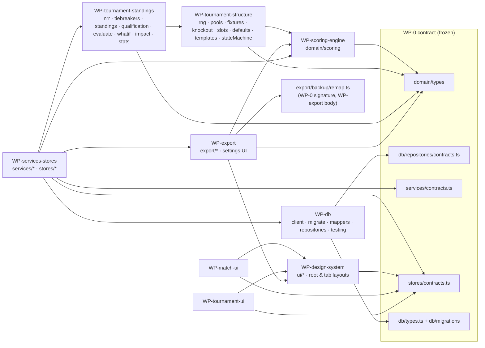

# Scorebook — Contracts & Implementation Work Packages

This is the build plan for parallel implementation. The contract (types, stub signatures, SQL schema, service/store/repository interfaces) is already in the repo and type-checks. Read [CLAUDE.md](../CLAUDE.md), [SPEC.md](SPEC.md), [ARCHITECTURE.md](architecture/ARCHITECTURE.md), [DATABASE.md](architecture/DATABASE.md), [STATE_MACHINES.md](architecture/STATE_MACHINES.md) and — for the exact meaning of every contract type, field and function — [CONTRACT_REFERENCE.md](architecture/CONTRACT_REFERENCE.md) first. Source files carry no comments (CLAUDE.md); CONTRACT_REFERENCE.md is where the per-symbol semantics live.

## 1. Module map

`WP-tournament-structure → WP-scoring-engine` is only for `presets.ts` data used by templates. `WP-tournament-standings → WP-tournament-structure` is only `knockout.knockoutAdvancer`, `stateMachine.tournamentEditPolicy`, `rng`, `pools.poolName`.

## 2. Contract rules (all packages)

1. **Do not change contract files** (owned by WP-0, listed in §4). If you need something, prefer an internal helper in a file you own. If the contract truly lacks something, you may only **add** (an optional field, a new union member, a new exported function in a file you own) — never rename, remove or change meaning — and you must list the addition under "Contract additions" in your result so the orchestrator can merge it. Stub signatures in files you own (incl. `src/export/backup/remap.ts`) are binding: keep names, parameters and return types; replace bodies. Their semantics are specified in CONTRACT_REFERENCE.md.
7. **No code comments anywhere** (CLAUDE.md) — not in implementation files, tests or SQL. Pragmas that tools need (`/** @jest-environment node */`) are the only exception. Explanations belong in docs.
2. Domain code is pure: no React/Expo/SQLite imports, no `Date.now()`, no `Math.random()`, no mutation of inputs, no `any`. Prefer `readonly` and discriminated unions; exhaustive `switch` with `never` checks.
3. Tests live in `__tests__/*.test.ts(x)` next to the code. DB tests use the sql.js adapter and start with `/** @jest-environment node */`. Every package's tests must pass with `npx jest <its folders>`; `npx tsc --noEmit` must be clean.
4. Never `npm install` / `npx expo install`. Report missing dependencies instead.
5. User-facing strings in domain outputs (result text, explanations, validation messages) are plain English, organizer-friendly, no technical jargon (§86, §98).
6. UI: semantic theme tokens only (no hex literals outside `src/ui/theme`), touch targets ≥ 44×44 (larger on the scoring pad), accessibility labels on every control, information never conveyed by colour alone (§71, §72, §78).

## 3. Work packages

### WP-0 — Architecture contract (done)
* **Owns:** `src/domain/types/**`, `src/domain/index.ts`, `src/domain/scoring/index.ts`, `src/domain/tournament/index.ts`, `src/db/types.ts`, `src/db/migrations/**`, `src/db/repositories/contracts.ts`, `src/services/contracts.ts`, `src/stores/contracts.ts`, the SIGNATURES of `src/export/backup/remap.ts`, `src/domain/__tests__/smoke.test.ts`, `src/db/__tests__/sqljs.test.ts` (moved from `src/domain/__tests__` at integration, so `src/domain` imports no SQLite), `src/__tests__/**` (the project-wide gate checks G-04 to G-08 of ACCEPTANCE_CRITERIA), `docs/**`.
* The schema in `001_initial.ts` is verified against the scenarios listed under WP-db (deferred cross-reference FKs, payload FKs, membership FKs, triggers, RESTRICT tournament delete).
* Barrels already export every contract module; packages do not edit them.

### WP-scoring-engine
* **Owns:** `src/domain/scoring/{replay,validate,commands,history,stats,format,result,presets,summary}.ts`, `src/domain/scoring/__tests__/**`, `src/domain/scoring/internal/**` (private helpers), `src/domain/scoring/testing/**` (public test builders: e.g. `matchSetup()`, `scriptedMatch()` that other packages may import in tests only).
* **Depends on:** WP-0 types.
* **Provides:** the §60 CricketRulesEngine: `replayMatch`, `applyEvent`, `validateEvent` (modes `append` / `replay`), `buildEvents` + intent constructors, undo/redo/history edits + `logFingerprint`, formulas, formatting, results (incl. par score), presets, `buildMatchSummary`, `SCORING_PROJECTION_VERSION` (bump it whenever replay/result/summary semantics change).
* **Acceptance tests (§90):**
  * Runs 0/1/2/3/4/6 (`scoreRuns`), all-run four (`{allRun: true}`), 1 + 4 overthrows via `overthrowBoundary(1)` (5 runs, strike rotates, not a "4", no UNUSUAL_RUNS); NB + 1 + 4 overthrows via `noBall({runsRun: 1, boundary: 4})`; team, batter (runs, balls, 4s, 6s, dots, SR) and bowler (balls, runs, dots, economy) figures.
  * Short runs: ran 2 with 1 short → 1 run, no change of ends; ran 3 with 1 short → 2 runs, change of ends; wide/bye/leg-bye with short runs; token `1s` and label; `INVALID_SHORT_RUNS`.
  * Law 16.6: need 1, one run completed, non-striker run out going for the 2nd → `WICKET_AFTER_RESULT`; recorded without the wicket → "won by 1 wicket" (9 down); stumping off a winning wide rejected; a wicket with the scores only level still counts; same in a super-over chase.
  * Wides: penalty 0/1/2, wide + runs, wide to the boundary (5 wd), `countsAsBall` variant; never a ball faced; always charged to bowler.
  * No-balls: + bat runs, + six, + byes (NB + 2 B), + leg-byes; penalty charged, byes not; ball faced; free hit set, carried through wide/no-ball, cleared after a fair ball; free-hit dismissal restrictions; `freeHit: false`.
  * Byes/leg-byes not charged; leg-bye ball is a bowler dot.
  * Every dismissal type incl. off-ball (timed out, backing-up run out) and retired out: who is out, bowler credit table, fielder rules, dismissal text; run out striker/non-striker × both ends × runs completed → correct next striker; caught → new batter on strike unless over ended; stumped off a wide keeps the wide.
  * End-of-over swap (vacancy swaps too); maiden rules (wide breaks, bye doesn't, split over never); consecutive-over rule; quota counted in distinct overs; mid-over replacement.
  * Innings end: all out (10 wkts, `playersPerSide` 8, last-man-stands lone batter with no rotation and all out at 8), overs complete, target reached mid-over, declared, batters unavailable (counts all out), match ended.
  * Targets, CRR, RRR, balls remaining; overs revision current innings (and = balls bowled → immediately complete), planned revision of a future innings, revised target → `method: revised_target`; powerplay phases and clamping.
  * Penalty runs with explicit `inningsIndex`: batting side (current innings; takes an in-progress chase past the target → `target_reached`); fielding side after batting (target rises); fielding side not yet batted (carried); penalty recorded after an innings-ending ball goes to that just-completed innings and turns a last-ball tie into a win; super-over penalty stays in its round and can never change a main-match total (`INVALID_PENALTY_INNINGS` for index 0/1 during a super over); valid while paused.
  * Par score: chase suspended at 14.2, `overs_revised { terminal, maxBalls: 86, target: par + 1 }` while paused → completion `terminated`, `confirm_result` outranks `resume_play`, `match_ended natural` valid while paused; ahead of par → "Lions won by 21 runs (par score)" (`method: 'par_score'`, runs margin to the chasing side); behind → side batting first wins by par − runs; level → "Match tied (par score)".
  * Revisions re-run completion (a revised target ≤ current runs → `target_reached`); `revise_overs { scope: 'both_innings' }` emits two events under one actionId; reducing innings 0 alone warns `CHASE_OVERS_NOT_REVISED`.
  * Uneven sides: `teamBPlayers: 7` in an 8-a-side match → B all out at 6 wickets; with last-man-stands B's survivor bats alone at 6 wickets and all out at 7; B winning a chase 3 down → "won by 3 wickets" (own threshold).
  * Substitutes: never openers/incoming batters/bowlers (`SUBSTITUTE_NOT_ALLOWED`), no batting row, not in "did not bat"; catch/run out by a sub → "c sub (Ali) b Hassan", "run out (sub (Ali))"; a sub cannot be removed once used as a fielder.
  * Fielders optional: caught without fielder → "c ? b Hassan" + warning `FIELDER_UNKNOWN`; stumping without fielder → `buildEvents` fills the designated keeper.
  * Absentees: `innings_ended { batters_unavailable, absentees }` → rows "absent hurt" / "absent", innings counts as all out; `INVALID_ABSENTEE` for players who batted.
  * Bowling: `bowler_selected.reason` (over_start at 0 balls only; injury/suspended mid-over only); a `suspended` bowler is `removed_from_attack` for the innings; `icc_one_fifth` quota for 17 overs (3 each, only two bowlers may bowl a 4th) and after a revision; super-over round 2: previous super-over bowler ineligible, batters dismissed in earlier super overs ineligible (`restrictRepeatPlayers`).
  * Results + text: win by runs, by wickets with balls left, tie, super over (win, tie again → repeat / boundary count / tie stands, max rounds), `tie_decided`, no result, abandoned before and during play, walkover only before deliveries, awarded with/without winner.
  * Pending-action priority for every prompt; `canRecordDelivery`; toss mismatch; squad validation.
  * Retirements: hurt/not out/out; resumption eligibility; mandatory retirement is advisory (`retirementsDue`, never blocks `canRecordDelivery`; `timing: 'end_of_over'`; not listed when no yet-to-bat batter remains; ignoring it and scoring on works); `returnedFromRetirement`.
  * Replay determinism; totality (property/fuzz test: random event arrays never throw, invalid events become error `issues` and `needsRepair`); one invalid event in the middle of a log skips ONLY that event (later events still apply; `lastSeq` = tail, `lastAppliedSeq` = last applied); a stale stamp in replay mode is a warning and the delivery is applied; incremental equivalence `applyEvent ∘ replayMatch = replayMatch` over randomly generated valid matches.
  * Undo/redo groups (wicket + batter undone together; redo restores identical events; redo after divergence → `REDO_STALE`).
  * History edits: 1 → 2 runs re-stamps later strikers; wide → legal re-anchors the next over's bowler selection one delivery earlier (and legal → wide later); removing a wicket without removing its `batter_in` fails `NO_VACANCY`; inserted events get ids/now and ONE FRESH actionId PER OP (an `insert_before` mid-log and an `insert_after` at the tail never share a group); `normalizeLog` idempotent; `resultChanged` accurate; `logFingerprint` changes when any event changes (incl. undo + new ball with the same lastSeq).
  * Formatting: `formatOvers` (6- and 8-ball), rates, NRR sign, figures, every token in the grammar, dismissal texts.
  * `buildMatchSummary`: allotted balls after revision, all-out flag, player lines exclude super overs, `squads` without substitutes, no tournament context fields, null for non-terminal; `summariesAffectStandingsEqually` detects changes of `targetRevised`, `ballsPerOver`, tie decider and margin.
  * Performance: replay of a 50-over match (~700 events) < 50 ms in node.

### WP-tournament-structure
* **Owns:** `src/domain/tournament/{rng,pools,fixtures,knockout,slots,defaults,templates,stateMachine}.ts` and their tests `src/domain/tournament/__tests__/{rng,pools,fixtures,knockout,slots,templates,stateMachine}.test.ts`.
* **Depends on:** WP-0; `scoring/presets.ts` data (already present).
* **Provides:** seeded RNG, pool assignment and transfers (members are `FixtureSide`s), round robin / custom encounters / manual fixtures / knockout brackets with byes, seeding, knockout advancement, slot expansion, templates, state machines and edit policies.
* **Acceptance tests (§90):** mulberry32 golden sequence for fixed seeds; `normalizeSeed("847291") === 847291`; shuffle is a permutation and reproducible; `distributePoolSizes(10,3) = [4,3,3]`; random assignment reproducible per seed, 16 teams → 4 pools of 4; snake seeding; `assignSlotsToPools` snake and fixed order (Super 8 from A1/B2/C1/D2); move/swap/replace of team AND slot members keep every other member in place; warnings (uneven, empty, single, duplicate, unassigned against the stage's entrants — a direct-entry team is not "unassigned" in stage 1). Round robin for n = 2…17 and 128: every pair meets once per leg, n−1 rounds (even) / n rounds with one bye (odd), no team twice per round, leg 2 mirrored, sideA balance within 1; drafts numbered from `startMatchNumber`; `validateFixtureDrafts` errors/warnings with per-pool legs (a double-RR 3-team pool beside single-RR pools raises no DUPLICATE_ENCOUNTER); `fixturesForPoolMove` removes only unplayed source-pool fixtures and creates fixtures against every target member; `scheduleSequential` never double-books a side on a day. Knockout: sizes 2…33 → correct byes to top seeds, standard order `[1,8,4,5,2,7,3,6]`, round names, progression slots `role: 'progression'` indexed from `firstSlotIndex` with `bracket_winner` sources (a re-draw with new fixture ids leaves them valid), `entrySlotSeeds`, final flagged `isFinal`, third-place fixture `kind: 'third_place'` from `bracket_loser` (never a `knockout_winners` source), `rounds: 1` stops after round 1; `bracketShape`; `seedEntrants` fixed cross-pool (A1 v B2, B1 v A2; 4 pools) producing a seed order paired 1vN, random reproducible, ranking; `knockoutGenerationGuard` refuses `ranking` with a provisional entry slot; `knockoutAdvancer` for win/walkover/awarded/tie decider/tie policies (super over still tied → organizer_required)/no-result policies incl. `higher_seed` from slot seeds and `shared`/not played, and the default config for custom stages. Slots: every rule kind expands with correct labels and indexes (`fromPosition`, `direct_entry`, `knockout_winners` from a bracket shape without fixtures); re-expansion keeps slot ids by index. Templates: five built-ins instantiate for their team counts with exactly one `decidesChampion` stage (8-team-t20: entry slots 0–3, progression 4–5); `templateFromSnapshot` round-trips structure incl. slot-built pools. State machines: every allowed and forbidden transition in STATE_MACHINES.md (incl. `paused → completed` natural, `abandoned → rescheduled` only with `replayAllowed`), and the §55 edit-policy matrix incl. seeds and tournament deletion.

### WP-tournament-standings
* **Owns:** `src/domain/tournament/{nrr,tiebreakers,standings,qualification,evaluate,whatif,impact,stats}.ts` and tests `src/domain/tournament/__tests__/{nrr,tiebreakers,standings,qualification,evaluate,whatif,impact,stats}.test.ts`.
* **Depends on:** WP-0; WP-tournament-structure (`knockoutAdvancer`, `tournamentEditPolicy`, `poolName`) — until those land, test slot resolution with `pool_position` sources first.
* **Provides:** the §41 NRR engine, §42 standings, §43 tie-breakers, §44–§51 qualification with certainty and explanations (per downstream stage), `evaluateTournament` (+ `resolveFixtureTeams`, `stageEntrants`), what-if (§48), `planChange` / `applyPlan` / impact (§34/§99), tournament statistics (§52).
* **Acceptance tests (§90):** points for every result type (super-over decided in both modes, walkover points, abandoned points, awarded without winner, bonus point); NRR: ICC worked examples (all out → full quota both ways; chase won early → actual balls; revised target and terminated par-score chase `icc_par` with par = target − 1), `actual_overs` mode, no-result/abandoned excluded and included, walkover exclude/notional, super overs ignored, mixed balls-per-over; tie-breakers: two-team H2H, three-team mini-league, `head_to_head_wins`, `head_to_head_nrr`, `headToHeadRequiresCompleteMiniLeague` skipping an incomplete mini-league, sequential chain without restart, organizer decision and draw-lots overrides; before any match (all level) nothing is reported as decision-required — only complete tables with a level group straddling a slot boundary go to `unresolvedTies`; standings: played/W/L/T/NR/pts/runs/overs/RR/NRR/remaining/form, points adjustments, expunged team, slot-member rows ("A1", provisional), `team_replace` with each `priorResults` policy (transfer aggregates X into Y; keep shows X as a non-qualifying row; expunge removes); uneven pools with `raw`, `per_match_average`, `drop_extra_results` (with `poolOrder`) and `comparisonTables`; qualification: top 2 per pool, pool winners + best runners-up across uneven pools, top N overall, positions 3–4 into a parallel Plate stage (targets for Cup and Plate), direct entries, manual slots, override qualify/eliminate/reassign, one ENTRY slot per team (the 8-team-t20 "Winner SF1" resolves although its occupant holds A1 — the §92 champion is decided); certainty: clinched / eliminated / in contention with exact enumeration over outcome sets derived from the points system (bonus, abandoned, walkover points) and conservative bounds above the limit; §98 explanation strings; frozen sides: correcting a group result after the SF was played changes the A1 slot but not the SF, "Winner SF1" or the champion (reported as a slot conflict); knockout slot resolution by bracket position and champion (`decidesChampion` stage — a Plate ordered last is not champion; custom `isFinal`; `champion` override; shared); what-if never mutates the (deep-frozen) snapshot and handles abandoned/walkover/tie-winner/bonus hypotheticals and chained QF → SF; `planChange` for every `ProposedChange` kind (pool_move deletes/creates exactly the listed fixtures; withdraw-walkover creates matches with `match_ended` events; stage_upsert re-expands dependent slots keeping ids) and `computeImpact == evaluate(applyPlan(planChange))` incl. `blocked`; 128 teams / 16 pools / ~500 fixtures evaluate < 100 ms; tournament stats records and `matches` from squads.

### WP-db
* **Owns:** `src/db/client.ts`, `src/db/migrate.ts`, `src/db/index.ts`, `src/db/mappers/**`, `src/db/repositories/**` except `contracts.ts`, `src/db/testing/**` (sql.js `SqlDatabase` adapter, seed helpers), `src/db/__tests__/**`.
* **Depends on:** WP-0 (`db/types.ts`, migrations, repository contracts, domain types).
* **Provides:** expo-sqlite adapter (WAL, `foreign_keys = ON`, `synchronous = FULL`, `withTransactionAsync(task(tx))` with a writer mutex), migration runner (`RunMigrations`, `foreignKeysOff` support), `createRepositories(db)` implementing every interface in `repositories/contracts.ts`, sql.js adapter for tests.
* **Acceptance tests (§91, §93):** runner: fresh DB → v1, re-run no-op, newer recorded version refused, failing migration rolls back, `foreignKeysOff` migration switches FKs off/on and aborts on a failing `foreign_key_check`, check skipped when nothing ran; transactions: concurrent `withTransactionAsync` calls are serialised, a task's statements through `tx` do not deadlock, and a write on the ROOT database during an open transaction waits and is NOT rolled back with it; every repository round-trips domain objects deep-equal (JSON columns, booleans, nullables, generated columns and `matchSides` ignored on write); `MatchEventRepository.append/truncateFrom/replaceAll`, stale writer rejected by `UNIQUE(match_id, seq)`, `truncateFrom` refuses a wrong expected tail; payload FKs: a player used only in `innings_started` / `batter_in` / `bowler_selected` / `batter_dismissed` fielders cannot be removed, and `removeSquadPlayer` refuses an absentee; the DATABASE.md negative cases are rejected (fixture of another tournament, non-member pool/fixture teams, squad of a third team, progression slot with a pool source, second final, duplicate bracket position, tournament delete with matches, venue delete in use); a knockout tournament with completed matches is exported and re-imported in one transaction (deferred FKs); two-phase `upsertPools`/`upsertSlots` swap two order indexes; history list filters/search/sort/paging and `findResumable({forPrompt})`; `getSnapshot` of a full tournament incl. `version`, frozen `matchSides`, summaries and `staleSummaryMatchIds`; `bumpRevision`, `writeChampion`, list `championName` and SQL fixture counts; `applyPlanRows` for every plan section; `writeProjection` replaces innings/partnership rows and stores `projection_version`; backup `exportData`/`importData` round-trip, `deleteAggregate`, no `INSERT OR REPLACE`; appending a ball + projection write < 10 ms on sql.js.

### WP-services-stores
* **Owns:** `src/services/**` except `contracts.ts`, `src/stores/**` except `contracts.ts`, and their `__tests__`.
* **Depends on:** all contracts; implementations of WP-scoring-engine, WP-tournament-*, WP-db, WP-export (builders only). Start against contracts with in-memory fakes; switch to real modules as they land.
* **Provides:** `AppServices` (bootstrap, id/clock, haptics & sound adapters honouring settings §76–§77) and every store hook in `stores/contracts.ts`, including the stores added at wave-1 integration (`useTeamLibraryStore`, `useExportStore`, `useBackupStore`) and the added actions on the existing stores (gap register G-1 to G-10 in [docs/README.md](README.md)). Also provides a `CreateAppServices` factory over `ServiceDeps` for the app, the `createTestApp(db, deps)` harness, and `src/stores/services.ts` (`setAppServices` / `getAppServices`, typed by `AppServicesRegistry`).
* **Acceptance tests (§91–§93, sql.js):** match lifecycle create (match + squads + `innings_started` in one transaction) → score → persist → new service instance → resume → innings break → chase → `confirm_result` → completed → scorecard data; SAVE & EXIT hides the match from the startup prompt until the next ball; undo (`truncateFrom`) and redo persisted, redo of a `match_ended` group of a tournament match needs a reason and is audited; failure injection mid-transaction leaves DB and store unchanged; stale `expectedLastSeq` → `CONFLICT`; a log with an invalid mid-log event → `needsRepair`, `record` refused, projections untouched, repaired by a history edit; walkover/abandon/no-result flows update fixture mirrors, revision and audit; historical edit of a completed tournament match → impact preview, reason required, `CONFLICT` when the log changed since the preview (fingerprint), audit with removed/inserted events and the previewed impact, standings change; a live-match edit is audited too; `applyChange` with a stale `ChangePreview.version` → `CONFLICT`; bootstrap rebuilds projections with an older `projection_version`; tournament delete needs the typed name and the completed-matches opt-in and deletes matches explicitly; full §92 tournament: 8 teams → 2 pools → single RR → top 2 → semifinals → final → champion (champion projection in the tournaments list), with standings/NRR/qualification asserted after each match; import of a duplicate backup → aggregate conflicts preview (`previouslyImportedAt`), `skip_existing` (nothing merged), `import_as_copy` (every match replays cleanly), `replace_existing` (local-only matches reported first); stores: dispatch serialisation, redo cleared on dispatch/open/CONFLICT, errors surfaced as `ServiceError`, `useTournamentStore` refresh after match completion and apply only with the kept preview.

### WP-design-system
* **Owns:** `src/ui/**`, `src/app/_layout.tsx`, `src/app/(tabs)/_layout.tsx`; deletes the placeholder `src/app/index.tsx` (Home moves to `(tabs)/index.tsx`, owned by WP-match-ui).
* **Depends on:** `stores/contracts.ts` (`useAppStore`, `useSettingsStore`, `useToastStore` in the layouts only). `src/ui` itself imports no domain/stores.
* **Provides:** tokens (§67–§71: colours for light and dark designed separately, spacing 4…48, radius, borders, shadows, typography with Inter + Barlow Condensed for score figures), `ThemeProvider`/`useTheme` (Light/Dark/System), primitives (Button, IconButton, TextField, Stepper, SegmentedControl, Sheet, Dialog, Toast host, ListRow, Table, Badge, EmptyState, ErrorState, Skeleton), scoreboard presentational pieces (ScoreFigure, BallChip `{text, kind, isFreeHit}`, OverStrip, StatLine), chart wrappers, root bootstrap gate and tab bar.
* **Acceptance tests:** every §71 token defined in both themes; text/background contrast ≥ 4.5:1 (≥ 3:1 large score text) computed in tests; hit slop/targets ≥ 44; primitives render and expose accessibility roles/labels (RNTL); reduced-motion honoured; no hex literals outside `src/ui/theme` (grep test); theme switches without remount of screens.

### WP-match-ui
* **Owns:** `src/features/{home,match-setup,scoring,scorecard,history,teams}/**`, `src/app/(tabs)/index.tsx`, `src/app/(tabs)/history.tsx`, `src/app/match/**`, `src/app/teams/**`.
* **Depends on:** `stores/contracts.ts`, WP-design-system, domain types + `scoring/format` helpers (no maths in components).
* **Provides:** Home with resume prompt (§23, §79), match setup wizard (§64), live scoring (§9–§21), scorecard, ball log, historical edit with WHAT WILL CHANGE (§16), analytics, history (§81), team library (§27).
* **Acceptance tests (RNTL, stores mocked):** `0 1 2 3 4 6` each dispatch one intent with one tap; extras sheet covers WD+n, NB + bat/B/LB, B, LB and custom values (§17); wicket flow for bowled/caught including fielder and next batter in ≤ 3 taps; every `PendingAction` renders its prompt; header shows score, overs, CRR, RRR, target, runs required, balls remaining (§10) from state; striker indicator not colour-only (§11); bowler line (§12); current over tokens (§13); swap strike, undo, redo; resume prompt RESUME / SAVE & EXIT / DISCARD; history search/filter/sort; scorecard sections; edit flow shows the preview and requires a reason for completed matches; tablet two-pane layout (§74) at ≥ 768 dp.

### WP-tournament-ui
* **Owns:** `src/features/tournament/**`, `src/features/shared/**` (ImpactSheet, ReasonField, ManualOverrideBadge, QualificationText, TypedNameConfirm; WP-match-ui consumes them for edit ball and reopen, gap G-12), `src/app/(tabs)/tournaments.tsx`, `src/app/tournament/**`.
* **Depends on:** `stores/contracts.ts`, WP-design-system, domain types/format helpers.
* **Provides:** tournaments list (§82), creation wizard (§25, resumable drafts), dashboard (§49, §80), standings (§50–§51), fixtures list/detail/edit/add (§35–§39), pools editor with impact (§30–§34), stage builder and slots (§29, §44, §45), qualification with overrides (§47, §98), bracket (§46), what-if (§48), stats (§52), audit log (§53), tournament teams and manage screen.
* **Acceptance tests (RNTL, stores mocked):** wizard step validation and progressive save; random pool preview shows the seed and "Current pool arrangement will be replaced." before replacing (§31); uneven-pool warning (§32); move/swap/replace open the impact sheet and apply only on Continue (§34); fixture preview edit/confirm (§36); standings columns Pos, Team, P, W, L, NR, Pts, NRR with qualification text (§50–§51); tie-break explanation visible; override requires a reason and shows "Manual Override" (§47); bracket renders byes and slot labels; what-if never calls `applyChange`; dashboard shows progress "24/48", next match, current stage without card-per-statistic layout.

### WP-export
* **Owns:** `src/export/**` (the signatures of `src/export/backup/remap.ts` are WP-0 contract; WP-export writes the bodies), `src/features/settings/**`, `src/app/(tabs)/settings.tsx`, `src/app/settings/**`.
* **Depends on:** WP-0 types, WP-scoring-engine (format helpers), `stores/contracts.ts` (settings/backup screens), WP-design-system.
* **Provides:** pure HTML builders for the scorecard PDF (§83) and tournament summary PDF (§82), backup envelope builder (canonical JSON with sorted keys, counts, `exportId`, checksum input), `collectIdReferences` / `remapBackupIds` (one exhaustive visitor incl. ids inside event payloads, stage config, slot sources, override payloads, venue lists), backup validation producing `ImportPreview` (structure, versions, duplicate ids, references from `collectIdReferences`, event logs via `validateLog`, conflicts per aggregate with local-only counts), settings screens (theme, haptics, sound, reduced motion, scoring preferences, default format), backup/import screen, format presets screen, diagnostics screen (incl. an on-demand `foreign_key_check` and matches that need repair).
* **Acceptance tests:** scorecard HTML contains title, teams, venue, date, result, toss, batting (incl. "absent hurt", "c sub (X) b Y"), bowling, extras, fall of wickets, partnerships, over summary and (tournament) standings; HTML-escapes names; light "print" styling independent of app theme; envelope deterministic for identical data; validation flags invalid JSON, wrong format, unsupported format version, schema too new, checksum mismatch/missing, duplicate ids, missing references (incl. a player id inside an event payload), invalid event logs, id conflicts per aggregate; `remapBackupIds` of a full tournament backup leaves no original id in any reference (audit values excepted) and every remapped match replays with zero issues; settings toggles persist through the store.

## 4. File ownership index (no overlaps)

| Path | Owner |
|---|---|
| `src/domain/types/**`, `src/domain/index.ts`, `src/domain/{scoring,tournament}/index.ts`, `src/domain/__tests__/*`, `src/db/__tests__/sqljs.test.ts`, `src/__tests__/**` | WP-0 |
| `src/domain/scoring/**` (except `index.ts`) | WP-scoring-engine |
| `src/domain/tournament/{rng,pools,fixtures,knockout,slots,defaults,templates,stateMachine}.ts` + matching tests | WP-tournament-structure |
| `src/domain/tournament/{nrr,tiebreakers,standings,qualification,evaluate,whatif,impact,stats}.ts` + matching tests | WP-tournament-standings |
| `src/db/types.ts`, `src/db/migrations/**`, `src/db/repositories/contracts.ts` | WP-0 |
| `src/db/**` (everything else) | WP-db |
| `src/services/contracts.ts`, `src/stores/contracts.ts` | WP-0 |
| `src/services/**`, `src/stores/**` (everything else) | WP-services-stores |
| `src/ui/**`, `src/app/_layout.tsx`, `src/app/(tabs)/_layout.tsx`, removal of `src/app/index.tsx` | WP-design-system |
| `src/features/{home,match-setup,scoring,scorecard,history,teams}/**`, `src/app/(tabs)/index.tsx`, `src/app/(tabs)/history.tsx`, `src/app/match/**`, `src/app/teams/**` | WP-match-ui |
| `src/features/tournament/**`, `src/features/shared/**`, `src/app/(tabs)/tournaments.tsx`, `src/app/tournament/**` | WP-tournament-ui |
| `src/export/**` (signatures of `src/export/backup/remap.ts`: WP-0), `src/features/settings/**`, `src/app/(tabs)/settings.tsx`, `src/app/settings/**` | WP-export |
| `docs/**` | WP-0 |

## 5. Integration order

1. **Wave 1 (parallel):** WP-scoring-engine, WP-tournament-structure, WP-tournament-standings, WP-db, WP-design-system, WP-export (builders/validation first).
2. **Wave 2:** WP-services-stores (against real domain + db), WP-match-ui and WP-tournament-ui (against store contracts with mocked stores from wave 1 onwards).
3. **Wave 3:** end-to-end wiring, `npx expo export --platform android` bundle check, §92 scenario.

## 6. Open questions for the product owner

1. **Wide/no-ball variants:** besides `countsAsBall`, do organizers need "wide counts as a ball only in the last over" or "no free hit in gully mode" presets? (Modelled: per-match `countsAsBall`, `freeHit`.)
2. **Super-over tie in league tables:** default is ICC `win_loss`; some leagues award tie points and use super overs only in knockouts — confirm default.
3. **Abandoned vs no result:** both count as NR with `PointsSystem.abandoned` defaulting to no-result points — confirm, and whether "abandoned without a ball bowled" should count as played.
4. **Caught — new batter on strike (Law 18.11, 2022):** implemented as the default with manual swap for clubs on older Laws; is a rule toggle wanted?
5. **DLS:** out of scope; organizers type the revised target (optional average-run-rate suggestion). Acceptable for V1?
6. **Player identity:** players belong to a home team and can guest for others per match; cross-team career stats are future (§96).
7. **Logos in backups:** excluded (device file URIs). Embed as base64 later?
8. **Full (concussion / like-for-like) replacements:** V1 models substitute FIELDERS (`isSubstitute`) only; a full replacement is added as an ordinary squad member and the replaced player simply takes no further part (not enforced). Enforcing it needs a `player_replaced` event — wanted?
9. **Bowler quota default:** built-ins use `uniform` ⌈overs ÷ 5⌉ (gully/club norm); `icc_one_fifth` is available per match. Should formal (tournament) presets default to `icc_one_fifth`?
10. **Par-score wording:** result text says "(par score)" rather than "(DLS method)" because the app does not compute DLS; organizers may type a DLS/VJD/average-run-rate par. Confirm the wording.
