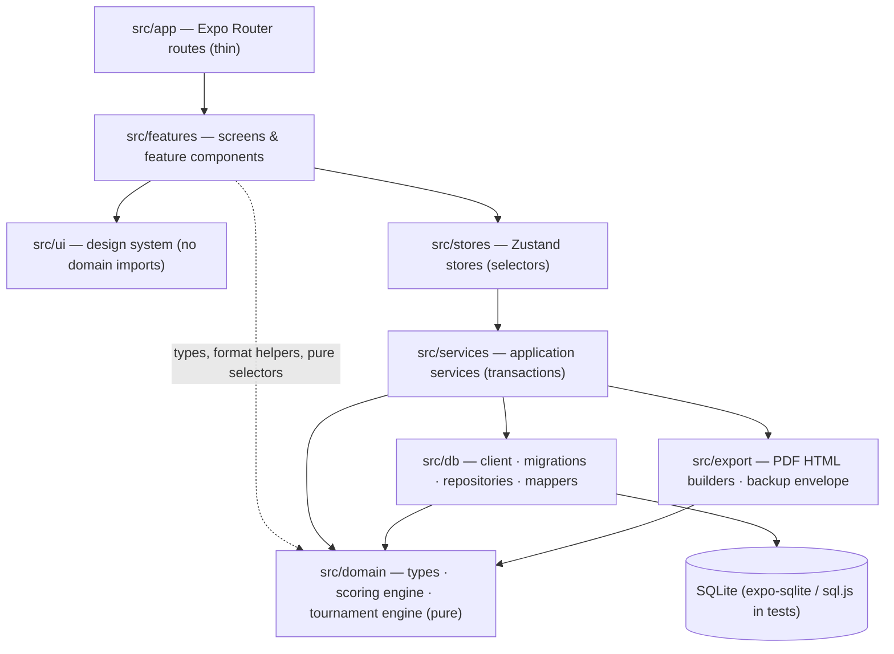
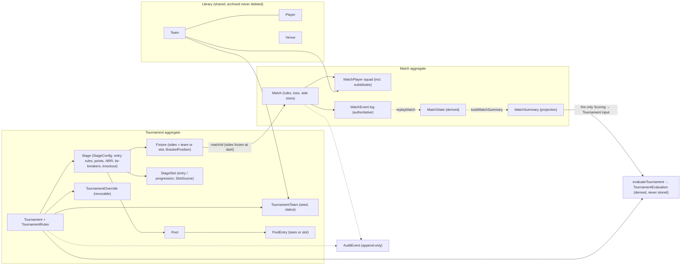
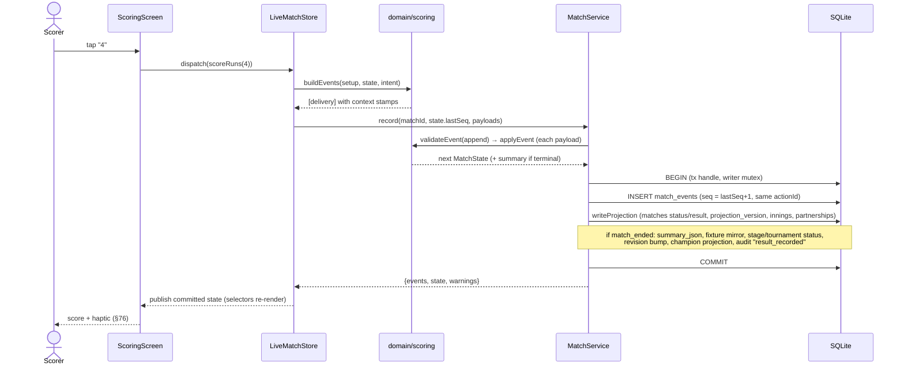
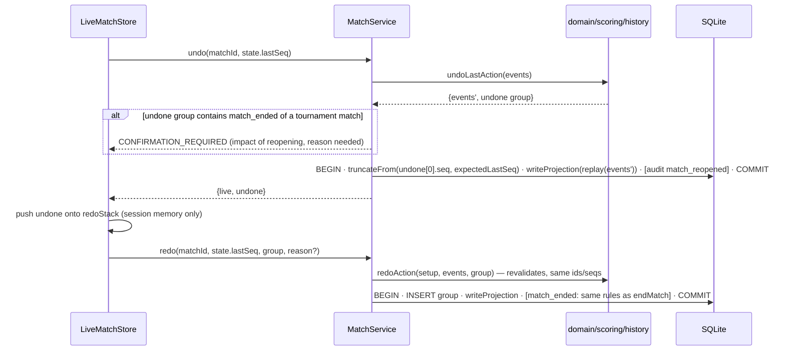

# Scorebook — System Architecture

Offline cricket scorer and tournament manager (Expo SDK 57, React Native 0.86, TypeScript, Expo Router, expo-sqlite, Zustand). This document is the architecture contract; types and stubs in `src/**/contracts.ts`, `src/domain/**`, `src/db/**` and `src/export/backup/remap.ts` are its executable form, and [CONTRACT_REFERENCE.md](CONTRACT_REFERENCE.md) holds the per-symbol semantics of every contract type, field and function (the source files carry no comments, per CLAUDE.md). Section references (§N) point to [SPEC.md](../SPEC.md). Companion docs: [DATABASE.md](DATABASE.md), [STATE_MACHINES.md](STATE_MACHINES.md), [CONTRACTS.md](../CONTRACTS.md); the index of all design documents, the MVP traceability matrix and the contract gap register are in [docs/README.md](../README.md).

## 1. Principles

1. **The match event log is the truth** (§14, §59). Scores, cards, partnerships, results, standings, NRR and qualification are *derived* by pure domain engines. Stored summaries are recomputable projections.
2. **Pure domain** — no React, Expo, SQLite, clock or `Math.random` in `src/domain`. Ids, time and random seeds are injected, so every computation is deterministic and testable.
3. **One use case = one SQLite transaction** (§89), executed through the transaction's own handle (`withTransactionAsync(async (tx) => …)`); nothing outside the use case can join it. A ball never partially modifies a match, and every committed ball is durable (`synchronous = FULL`).
4. **Rules are data** (§40–§44, §97) — match rules, points, NRR mode, tie-breakers and qualification slots are stored values that engines interpret.
5. **Automation with transparent override** (§54, §98, §99) — every automatic decision carries an explanation; every change to completed data shows WHAT WILL CHANGE first and is audited.
6. **Thin UI** — screens render domain outputs through stores; they never compute cricket maths or touch SQL (§60, §103).

## 2. Layers



| Layer | May import | Must not |
|---|---|---|
| `app/` | `features/` | contain logic or styles beyond layout wiring |
| `features/` | `ui/`, `stores/`, `domain/` (types, `scoring/format`, `scoring/replay#currentInnings`, pure selectors) | import `db/` or `services/` implementations; compute scores/standings |
| `ui/` | React Native, theme | import `domain/`, `stores/`, `services/` |
| `stores/` | `services/contracts`, `domain/` | run SQL; hold one global mega-state (§88) |
| `services/` | `domain/`, `db/`, `export/` | render UI; hard-code rules |
| `domain/` | nothing outside `domain/` | touch I/O, clock, randomness |
| `db/` | `domain/types` | contain cricket/tournament logic |
| `export/` | `domain/` | perform I/O (services write files, print, share) |

## 3. Bounded contexts

| Context | Owns | Key modules | Output consumed by others |
|---|---|---|---|
| **Scoring** (§6–§23) | Match rules, event log semantics, replay, validation, undo/redo/edit, stats formulas, result text | `domain/scoring/*` | `MatchState` (UI), `MatchSummary` (tournament), `MatchProjection` (db via services) |
| **Tournament** (§24–§56) | Structure (stages, pools, slots, fixtures), points, NRR, tie-breakers, qualification, knockout, what-if, impact, state machines, templates | `domain/tournament/*` | `TournamentEvaluation`, `ImpactSummary`, `WhatIfResult`, drafts |
| **Persistence** (§57–§59, §89) | Schema, migrations, repositories, projections storage, transactions | `db/*` | domain objects, read models |
| **Export** (§83, §84) | PDF HTML, backup envelope/validation | `export/*` | HTML strings, `BackupEnvelope`, `ImportPreview` |
| **App shell / Settings** | Theme, preferences, bootstrap, navigation | `ui/theme`, `services/settings`, `app/_layout.tsx` | `AppSettings` |

The only coupling between Scoring and Tournament is **`MatchSummary`** (built by `scoring/summary.ts` from a terminal match). The tournament engine never reads events; the scoring engine never reads tournaments. A tournament fixture opens the *same* scoring engine as a standalone match (§66).

### 3.1 Domain model (§102 "domain architecture")

Aggregates are the units of consistency. A use case normally changes one aggregate (plus the documented tournament side effects of a tournament match changing: fixture mirror, stage/tournament status, revision, champion projection); backup import, tournament deletion and `team_withdraw` walkovers span several, and every use case is still exactly one transaction (DATABASE.md §6). Every type named here is defined in `src/domain/types` and specified in [CONTRACT_REFERENCE.md](CONTRACT_REFERENCE.md).



| Aggregate | Root | Members | Invariants the root protects | Derived (never authoritative) |
|---|---|---|---|---|
| Match | `Match` | `MatchTeam`/`MatchPlayer` squad, `MatchEvent` log | seq 1..n contiguous; one `actionId` = one contiguous run; events name only squad members; toss matches innings 1; status ⇔ result (D5); no write keeps a `needsRepair` log degraded | `MatchState`, `InningsState`, `BallRecord`, cards, partnerships, `MatchResult`, `MatchSummary`, projections |
| Tournament | `Tournament` (+ `revision` → `TournamentSnapshot.version`) | `TournamentRules`, `TournamentTeam`, `Stage`, `Pool`, `PoolEntry`, `StageSlot`, `Fixture`, `TournamentOverride` | membership (pool entries, fixture sides and matches reference tournament teams); one team per pool per stage; one entry slot per team per stage; ≤ 1 final per stage; exactly one `decidesChampion` stage; state-machine guards and edit policies (STATE_MACHINES.md) | standings, NRR, slot resolutions, qualification, champion (`TournamentEvaluation`); `champion_json` projection |
| Library | `Team`, `Player`, `Venue` (each its own root) | — | referenced rows are archived, never deleted (FK RESTRICT) | — |
| Configuration | `AppSettings`, `FormatPreset`, `TournamentTemplate` | — | presets and templates only pre-fill; changing them never changes a stored match or tournament | — |
| Audit | `AuditEvent` | — | append-only; stores the impact the organizer confirmed | — |

**Value objects** (immutable, compared by value, stored as JSON or columns): `MatchRules` (`WideRule`, `NoBallRule`, `PowerplayRule`, `SuperOverRule`, `MandatoryRetirementRule`), `Toss`, `MatchResult` / `WinMargin` / `TieDecider`, event payloads, `PointsSystem`, `NrrConfig`, `TieBreakerKind[]`, `QualificationRule`, `SlotSource`, `KnockoutConfig`, `FixtureSide`, `BracketPosition`, `ProposedChange`, `ChangePlan`, `ImpactSummary`, `BallToken`.

**Domain services** (pure functions, no state): the CricketRulesEngine (`scoring/replay`, `validate`, `commands`, `history`, `result`, `summary`, `stats`, `format`, `presets`) and the tournament engines (`rng`, `pools`, `fixtures`, `knockout`, `slots`, `templates`, `stateMachine`, `nrr`, `tiebreakers`, `standings`, `qualification`, `evaluate`, `whatif`, `impact`, `stats`). Engineering designs: [SCORING_ENGINE.md](../engineering/SCORING_ENGINE.md), [TOURNAMENT_RULES_ENGINE.md](../engineering/TOURNAMENT_RULES_ENGINE.md), [STANDINGS_CALCULATOR.md](../engineering/STANDINGS_CALCULATOR.md), [NRR_CALCULATOR.md](../engineering/NRR_CALCULATOR.md), [QUALIFICATION_ENGINE.md](../engineering/QUALIFICATION_ENGINE.md).

**Ubiquitous language.** *Delivery* (one ball, legal or not) · *legal ball* (counts towards the over; overs are stored as legal-ball counts) · *action group* (events of one user action, the unit of undo) · *phase* (the main match or one super-over round, for penalties) · *slot* (a placeholder such as "A1" or "Winner SF1" resolved to a team by the engine) · *entrant* (a team or slot entering a stage) · *frozen sides* (a fixture's teams once its match starts) · *impact* (WHAT WILL CHANGE, §99) · *override* (a revocable organizer decision layered on automation, §47). UI copy uses the labels in [INFORMATION_ARCHITECTURE.md §5](../ux/INFORMATION_ARCHITECTURE.md).

## 4. Key design decisions

| # | Decision | Why |
|---|---|---|
| D1 | Single ordered log `match_events` per match; deliveries in typed columns, other kinds as JSON payload | One authoritative order for replay; typed + CHECK-constrained ball rows (§14/§58); flexible rare events. See DATABASE.md §3. |
| D2 | Strike, over/ball numbers, legality, totals, completion and results are **derived**; deliveries carry striker/non-striker/bowler as validated **stamps** | Historical edits (1 run → 2 runs) re-attribute later balls correctly; stamps keep rows self-describing and are re-stamped by `history.normalizeLog`. On append a stale stamp is an error; on replay it is only a warning (derived data never vetoes an authoritative delivery). |
| D3 | Delivery facts = umpire call + `runsTo` + `runsRun` + `shortRuns` + `boundary` + wicket | Captures exactly what the Laws need: odd *run* crossings rotate strike, boundaries don't; short runs are crossed but not scored (Law 18.5); overthrows; NB + byes; wide boundary. |
| D4 | Natural completion requires an explicit `match_ended {natural}` (pending action `confirm_result`) | A mis-tapped final ball can be undone before standings, NRR and qualification change (§66). Valid while paused, so a rain-terminated chase is confirmed without a fake resume. |
| D5 | `MatchStatus` (lifecycle) vs `MatchResult` (outcome) | §22 mixes both; tie/no-result/walkover are results of a `completed` match; `abandoned` is both a status and a result type (status/result table in CONTRACT_REFERENCE.md, `match.ts`). |
| D6 | Super overs are extra innings (`kind: super_over`) in the same log; each super-over round is its own penalty **phase** | §21: never corrupt the main innings; excluded from NRR and player aggregates; a super-over penalty can never reach a main-match total. |
| D7 | Undo unit = action group (`actionId`), which is always ONE contiguous run; undo = `truncateFrom(seq)` | "Wicket + next batter" undoes as one step; redo re-appends the identical events; domain group and deleted rows can never differ. |
| D8 | Qualification via **slots** with typed sources and a role (`entry` / `progression`); fixtures reference team *or* slot; bracket progression references **bracket positions**; a fixture's sides **freeze** when its match starts | §45 dynamic later stages (Super 8 pools, SF/Final) created before teams are known; re-draws keep references valid; a later correction can never rewrite a played knockout match. |
| D9 | One NRR engine over `MatchSummary` with `NrrConfig` | §41 all-out/revised/par-score/no-result/walkover handling configurable, never duplicated. |
| D10 | Tournament state computed on demand from a versioned `TournamentSnapshot` (`evaluateTournament`) | Standings are cheap to compute (≤128 teams); nothing to keep in sync; what-if/impact are "evaluate twice and diff"; the version (`tournaments.revision`) makes preview == apply. |
| D11 | Manual overrides are records layered on automation, never edits of computed data | §47 visible "Manual Override" + audit + revocable. |
| D12 | Seeds for all randomness, stored with the result | §31 reproducible draws, undoable, explainable. |
| D13 | One interpretation of every tournament change: domain `planChange` → typed `ChangePlan`; preview evaluates it, the service persists the same plan | §34/§99 WHAT WILL CHANGE is exactly what is written; walkovers of a withdrawn team are real matches with `match_ended` events. |
| D14 | Per-team side size (`Match.teamAPlayers/teamBPlayers`) and substitute fielders (`MatchPlayer.isSubstitute`) are match data | Short/uneven gully sides and Law 24 substitutes score correctly (all-out threshold, last man stands, wickets margin, "c sub (X)"). |
| D15 | Projections carry the engine version (`matches.projection_version` vs `SCORING_PROJECTION_VERSION`); bootstrap rebuilds stale ones | An engine fix corrects every stored score line, summary and standing without manual edits (§59). |
| D16 | A log with error-severity replay issues `needsRepair`: writes that keep it degraded are refused | One bad event can never silently truncate standings or poison later appends; repair = history edit / undo that replays cleanly. |

## 5. Data flows

### 5.1 Scoring a ball end to end, with transaction and recovery (§23)



* **Failure** (constraint, disk, stale `expectedLastSeq`): ROLLBACK, `ServiceError` → store keeps the previous state → toast "Couldn't save this delivery. Your previous match data is still safe. [Try Again]" (§86). Diagnostics go to settings → diagnostics.
* **Degraded log** (an event fails to replay, e.g. after an engine upgrade): replay skips only that event (seq order is checked against the previous event read, so the tail still replays), marks `needsRepair`, and every write that would keep the log degraded is refused ("This match needs repair"); projections are never rewritten from it. Repair = history edit or undo whose result replays cleanly.
* **Crash/battery loss** at any instant: SQLite atomicity (+ `synchronous = FULL`) means the ball either exists completely or not at all. On launch `bootstrap()` runs migrations (FK check only if one ran), rebuilds stale projections, replays live/paused matches, then `findResumable({forPrompt: true})` returns live/paused matches not dismissed → Home shows `MATCH IN PROGRESS / Pakistan XI 142/4 16.4 overs / [RESUME] [SAVE & EXIT] [DISCARD]`. RESUME = `load()` = events → `replayMatch` → identical state. SAVE & EXIT keeps it live and stores `resume_dismissed_at` (no prompt until the next ball; still under Continue Match). DISCARD deletes an unfinished standalone match after confirmation (tournament matches cannot be discarded).
* **Match creation**: `createMatch(input, [innings_started])` writes the match, squads and opening event in one transaction, so a crash never leaves a created-but-unstarted match.
* **Latency**: validation + `applyEvent` are O(1); one INSERT + a few projection UPDATEs in WAL mode stay well under a frame on mid-range phones. The store serialises dispatches (a second tap waits for the first commit).

### 5.2 Undo / redo (§15)



Undo is unlimited and always recomputes by replay (never `score − 1`). The redo stack is session-scoped: `open`, `close`, a CONFLICT reload and any new `dispatch` clear it, and it does not survive a restart.

### 5.3 Historical edit with tournament recalculation and warnings (§16, §34, §99)

```mermaid
sequenceDiagram
  actor Org as Organizer
  participant UI as EditBallScreen
  participant MS as MatchService
  participant H as scoring/history
  participant SUM as scoring/summary
  participant IMP as tournament/impact
  participant DB as SQLite
  Org->>UI: 17.3 FOUR → Wide
  UI->>MS: previewHistoryEdit(matchId, [replace seq 214])
  MS->>H: applyHistoryEdits(setup, events, ops) — normalise (re-anchor bowlers, renumber, restamp, fresh actionId per op), validate
  H-->>MS: before/after MatchState, diff, affectedInnings, resultChanged
  opt match is terminal and in a tournament
    MS->>SUM: buildMatchSummary(after)
    MS->>IMP: computeImpact({match_result_change}, snapshot)
    IMP-->>MS: ImpactSummary (standings, NRR, qualification, slots)
  end
  MS-->>UI: preview + baseFingerprint = logFingerprint(events)
  Org->>UI: Continue (+ reason when completed/tournament)
  UI->>MS: applyHistoryEdit(matchId, ops, reason, baseFingerprint)
  MS->>DB: BEGIN · fingerprint unchanged? else CONFLICT · replaceAll(events) · writeProjection · fixture mirror · revision bump · audit (match_history_edited / result_corrected: removed + inserted events, impact) · COMMIT
  MS-->>UI: LiveMatch; TournamentStore.refresh()
```

Edits of a live match are warned (`matchEditPolicy.history = warn`); edits of completed matches need confirmation and a reason; every applied edit — live or completed — is audited with the removed and inserted events so it can be reverted by hand. Tournament consequences are recomputed from summaries on the next evaluation — nothing else needs updating because standings are never stored.

### 5.4 Match completion → standings and qualification (§42, §66)

A fixture's sides are resolved from its slots only until its match starts; `startFixtureMatch` creates the match with the sides resolved at that moment, and from then on `Fixture.matchSides` (joined from the match row) is the only source of that fixture's teams.

```mermaid
sequenceDiagram
  participant ST as LiveMatchStore
  participant MS as MatchService
  participant DB as SQLite
  participant TS as TournamentStore
  participant TSV as TournamentService
  participant EV as tournament/evaluate
  ST->>MS: record(match_ended {natural})
  MS->>DB: BEGIN · INSERT event · matches(status=completed, result, summary_json) · fixtures.status=completed · stage/tournament status · revision++ · champion projection · audit result_recorded · COMMIT
  MS-->>ST: state (lifecycle completed)
  ST->>TS: invalidate(tournamentId)
  TS->>TSV: evaluate(tournamentId)
  TSV->>DB: getSnapshot (version, fixtures with frozen matchSides, summaries of current terminal matches)
  TSV->>EV: evaluateTournament(snapshot)
  EV-->>TSV: tables (points, NRR), slots (A1, B2, Winner SF1…), qualification per downstream stage (+ certainty, explanation), champion
  TSV-->>TS: snapshot + evaluation
  Note over TS: Dashboard/standings re-render; next-stage fixtures show resolved teams;<br/>"Tigers have mathematically qualified for the Semifinal."
```

## 6. Repository structure

```
src/
├── app/                      Expo Router routes only (see §9). Read params → render a feature screen.
├── features/                 Screens + feature components, grouped by user area
│   ├── home/                 Home (§79), resume prompt (§23)
│   ├── match-setup/          Standalone/fixture match setup wizard (§6–§8, §64)
│   ├── scoring/              Live scoring screen, extras/wicket sheets, batter/bowler pickers, current over (§9–§21)
│   ├── scorecard/            Scorecard, ball log, historical edit, analytics (§16, §64, §83)
│   ├── history/              Match history list (§81)
│   ├── teams/                Team & player library (§27)
│   ├── tournament/           Wizard, dashboard, standings, fixtures, pools, stages, qualification, bracket, what-if, stats, audit
│   ├── settings/             Settings, backup/import, format presets, diagnostics
│   └── shared/               ImpactSheet, ReasonField, ManualOverrideBadge, QualificationText, TypedNameConfirm (COMPONENT_ARCHITECTURE §8)
├── ui/                       Design system — no domain imports
│   ├── theme/                Semantic tokens light/dark (§67–§71), ThemeProvider, useTheme
│   ├── typography/           Text styles (Inter, Barlow Condensed for scores)
│   ├── primitives/           Button, IconButton, TextField, Stepper, SegmentedControl, Sheet, Dialog, Toast host, ListRow, Table, Badge, EmptyState, ErrorState, Skeleton
│   ├── scoreboard/           Presentational scoreboard pieces (ScoreFigure, BallChip, OverStrip, StatLine) — plain props
│   └── charts/               Worm/Manhattan wrappers over react-native-gifted-charts
├── stores/                   Zustand stores, one per concern (+ contracts.ts)
├── services/                 Application services (+ contracts.ts), bootstrap, clock, ids, haptics/sound adapters
├── domain/
│   ├── types/                Domain model and read models (the shared contract)
│   ├── scoring/              Rules engine: replay, validate, commands, history, stats, format, result, presets, summary
│   └── tournament/           rng, pools, fixtures, knockout, slots, defaults, templates, stateMachine, nrr, tiebreakers, standings, qualification, evaluate, whatif, impact, stats
├── db/
│   ├── types.ts              SqlDatabase contract
│   ├── client.ts             expo-sqlite adapter (WAL, foreign_keys, synchronous FULL, transaction handle + writer mutex)
│   ├── migrate.ts            Migration runner
│   ├── migrations/           Frozen SQL migrations + ordered list
│   ├── mappers/              Row ⇄ domain mapping (JSON columns, booleans, nullables)
│   ├── repositories/         contracts.ts + one file per repository
│   └── testing/              sql.js adapter and seed helpers for node tests
└── export/
    ├── pdf/                  Scorecard / tournament HTML builders (pure strings) for expo-print
    └── backup/               Envelope build, canonical JSON, structural + referential validation, id reference visitor + remap (`remap.ts`) (pure)
```

## 7. Stores (`src/stores`, contracts in `src/stores/contracts.ts`)

| Hook | Holds | Main actions | Used by |
|---|---|---|---|
| `useAppStore` | bootstrap status, `BootstrapReport` (schema version, resumable matches, integrity issues) | `bootstrap`, `checkIntegrity` | root layout, diagnostics |
| `useLiveMatchStore` | `LiveMatch` (setup, events, state), session redo stack, error, warnings | `open`, `dispatch(intent)`, `undo`, `redo`, `addSquadPlayer` (incl. substitutes), `removeSquadPlayer`, `previewHistoryEdit` → `HistoryEditPreview`, `applyHistoryEdit(ops, reason, preview)`, `updateDetails`, `updateRules`, `setToss`, `setPrePlayStatus`, `loadAudit`, `close` | scoring, scorecard, ball log, edit, manage match |
| `useHomeStore` | resumable (Continue Match), recent matches, tournaments | `load`, `dismissResume`, `discard` | home |
| `useMatchHistoryStore` | query, paged `MatchListItem`s | `load`, `loadMore`, `remove` | history |
| `useMatchSetupStore` | `MatchSetupDraft` (in memory) | `update`, `startFromFixture`, `submit`, `reset` | match setup wizard |
| `useTournamentListStore` | `TournamentListItem`s | `load` | tournaments tab |
| `useTournamentStore` | snapshot (versioned) + evaluation of the open tournament | `open`, `refresh`, `previewChange` → `ChangePreview`, `applyChange(change, reason, preview)`, `whatIf`, `loadStats`, `loadAudit`, `updateFixture`, `addFixture`, `generateFixtures`/`confirmFixtures`, `setStatus`, `updateInfo`, `listTemplates`/`saveAsTemplate`, `previewDelete`/`delete` | all tournament screens |
| `useTournamentWizardStore` | current step + wizard draft (info, teams with seeds, rules, stages, pools, slots, pool assignment, fixture plan) | `resume`, `update`, `goTo`, `saveStep` (progressive persistence, §62), `commit`, `reset`, `listTemplates` | tournament wizard |
| `useSettingsStore` | `AppSettings` | `load`, `update` | settings, theme provider, haptics |
| `useToastStore` | transient toasts | `show`, `dismiss` | global host |
| `useTeamLibraryStore` | teams, venues, the open team with its players | `load`, `loadTeam`, `createTeam`, `updateTeam`, `archiveTeam`, `addPlayer`, `updatePlayer`, `archivePlayer`, `createVenue`, `archiveVenue` | teams screens, match-setup and wizard pickers |
| `useExportStore` | status, error | `scorecardPdf`, `tournamentPdf`, `share` | scorecard, tournament manage, backup |
| `useBackupStore` | exported file, import file, `ImportPreview`, `ImportReport` | `exportBackup`, `previewImport`, `applyImport`, `reset` | backup screen |

## 8. Services (`src/services`, signatures in `src/services/contracts.ts`)

| Service | Methods (abridged) |
|---|---|
| `MatchService` | `createMatch(input, openingEvents?)`, `load(id)`, `record(id, expectedLastSeq, payloads)`, `undo(id, seq, reason?)`, `redo(id, seq, group, reason?)`, `previewHistoryEdit(id, ops)` → `baseFingerprint`, `applyHistoryEdit(id, ops, reason, expectedFingerprint)`, `updateDetails`, `updateRules(id, {rules, teamSizes}, reason)`, `setToss(id, toss, reason)`, `addSquadPlayer(…, {isSubstitute})`, `removeSquadPlayer`, `setPrePlayStatus`, `endMatch(id, seq, outcome, reason)`, `discard`, `dismissResume`, `delete`, `list(query)`, `findResumable({forPrompt})`, `rebuildProjections(id)`, `auditLog(id, page)` |
| `TeamService` | `list`, `get`, `create(NewTeamInput)`, `update`, `archive`, `addPlayer`, `updatePlayer`, `archivePlayer`, `listVenues`, `createVenue`, `archiveVenue` |
| `TournamentService` | `create`, `list`, `snapshot`, `evaluate`, `updateInfo`, `addTeams({teamId, seed}[])`, `removeTeams`, `saveStructure({…, poolEntries})`, `previewPoolAssignment`, `generateFixtures(stage, {poolId, seed})` → `FixturePlan`, `confirmFixtures(plan)`, `addFixture`, `previewChange(change)` → `ChangePreview`, `applyChange(change, reason, preview)`, `updateFixture`, `startFixtureMatch(fixture, setup, openingEvents?)`, `applyOverride(…, version)`, `revokeOverride(…, version)`, `setStatus`, `whatIf`, `stats`, `auditLog`, `listTemplates`, `saveAsTemplate`, `previewDelete`, `delete(id, {typedName, deleteCompletedMatches})` |
| `BackupService` | `exportBackup(scope)`, `previewImport(fileUri)`, `applyImport(fileUri, policy)` — conflicts and policies per aggregate |
| `ExportService` | `scorecardPdf(matchId)`, `tournamentPdf(id)`, `share(uri, mime)` |
| `SettingsService` | `load`, `update(patch)` |
| `AppServices` | `bootstrap()` (open DB, migrate, rebuild stale projections, replay live/paused, resume prompt list), `newId()`, `checkIntegrity()`; built by `CreateAppServices(deps: ServiceDeps)` (database opener, clock, ids, seeds, file system, printer, sharer); stores reach it through `getAppServices()` |

All return `ServiceResult<T>`; each mutating call is one transaction on the transaction handle; tournament-affecting calls preview first (`ChangePreview` with the snapshot version), apply only if the version is unchanged, persist the domain `ChangePlan`, bump the tournament revision and write an audit entry with the previewed impact.

## 9. Navigation (Expo Router, `src/app`)

```
src/app/
├── _layout.tsx                      Root stack: fonts, ThemeProvider, bootstrap gate (useAppStore)
├── (tabs)/
│   ├── _layout.tsx                  Tabs: Home · Tournaments · History · Settings (§5)
│   ├── index.tsx                    Home (§79) incl. the §23 "MATCH IN PROGRESS" resume prompt
│   ├── tournaments.tsx              Tournaments list (§82)
│   ├── history.tsx                  Match history (§81)
│   └── settings.tsx                 Settings (§5, §70, §76, §77)
├── match/
│   ├── new/
│   │   ├── _layout.tsx              Setup wizard stack (§64)
│   │   ├── index.tsx                Match information, format/overs, rules (§6–§8)
│   │   ├── teams.tsx                Team A / Team B
│   │   ├── players.tsx              Squads
│   │   ├── toss.tsx                 Toss
│   │   └── openers.tsx              Opening batters + bowler → create match, start innings
│   └── [matchId]/
│       ├── _layout.tsx              Opens the match in useLiveMatchStore
│       ├── score.tsx                LIVE SCORING (§9–§21)
│       ├── scorecard.tsx            Scorecard (§83 content)
│       ├── balls.tsx                Ball-by-ball log (tap → edit)
│       ├── edit/[seq].tsx           Historical edit + WHAT WILL CHANGE (§16, §99)
│       ├── analytics.tsx            Worm, Manhattan, partnerships
│       └── manage.tsx               Details, rules, overs revision, suspend/resume, end match (abandon/no result/award)
├── teams/
│   ├── index.tsx                    Team library
│   └── [teamId].tsx                 Team and players
├── tournament/
│   ├── new/
│   │   ├── _layout.tsx              Create wizard (§25, §65)
│   │   ├── index.tsx                Information (§26)
│   │   ├── teams.tsx                Add teams (§27)
│   │   ├── structure.tsx            Structure or template (§28, §56)
│   │   ├── rules.tsx                Points, NRR, tie-breakers (§40–§43)
│   │   ├── pools.tsx                Random / manual pools (§30–§32)
│   │   ├── fixtures.tsx             Generate → preview → edit (§35, §36)
│   │   └── review.tsx               Review & confirm
│   └── [tournamentId]/
│       ├── _layout.tsx              Opens useTournamentStore
│       ├── index.tsx                Dashboard (§49, §80)
│       ├── standings.tsx            Pool tabs + overall (§50, §51)
│       ├── fixtures/index.tsx       Fixtures by stage / round / date
│       ├── fixtures/new.tsx         + Add Match (§37)
│       ├── fixtures/[fixtureId].tsx Fixture detail/edit, postpone/cancel, start match (§38, §39, §66)
│       ├── pools.tsx                Pools editor: move / swap / replace with impact (§33, §34)
│       ├── stages/index.tsx         Stage builder (§29)
│       ├── stages/[stageId].tsx     Stage config, entry rules, slots (§44, §45)
│       ├── qualification.tsx        Qualification status, explanations, overrides (§47, §51, §98)
│       ├── bracket.tsx              Knockout bracket (§46)
│       ├── what-if.tsx              What-if simulator (§48)
│       ├── stats.tsx                Tournament statistics (§52)
│       ├── audit.tsx                Audit log (§53)
│       ├── teams.tsx                Tournament teams: withdraw / replace
│       └── manage.tsx               Info, rules, status/archive, save as template, export, delete
└── settings/
    ├── backup.tsx                   Export / import JSON (§84)
    ├── presets.tsx                  Format presets (§8)
    └── diagnostics.tsx              Technical diagnostics (§86)
```

## 10. Cross-cutting

* **Errors (§86)**: services map every failure to `ServiceError` with a human message; raw errors only in diagnostics. Empty states (§87) are part of each feature.
* **Performance (§88)**: selector-based stores; `applyEvent` incremental on the live path; full replay only on open/undo/edit; `evaluateTournament` memoised per snapshot version; FlatList for long logs and fixtures.
* **Integrity (§93)**: foreign keys are always on; `PRAGMA foreign_key_check` runs after migrations, after an import and from Diagnostics (never a full scan on every launch); bootstrap rebuilds projections written by an older engine and replays live/paused matches; projections can be rebuilt (`rebuildProjections`) at any time because they are never the truth; a log that `needsRepair` is never written over.
* **Accessibility (§78)**: ball tokens and statuses always carry text + accessibility labels from the domain (`BallToken.accessibilityLabel`, qualification `explanation`).
* **Theming (§67–§71)**: only semantic tokens (`background`, `surface`, `surfaceElevated`, `textPrimary`, `textSecondary`, `textMuted`, `border`, `accent`, `success`, `warning`, `danger`, `score`); light and dark palettes designed separately.

## 11. Design decisions & review log

Adversarial review of the WP-0 contract (lenses: cricket-laws **L**, tournament **T**, persistence **P**). 62 findings: 62 applied (4 of them with one sub-point rejected or deferred, marked ◐), 0 rejected outright. The schema changes were verified in sql.js (deferred cross-reference FKs, payload FKs, membership FKs, triggers, RESTRICT tournament delete, `foreign_key_check` clean).

| # | Sev. | Decision | One line |
|---|---|---|---|
| L1 | critical | accepted | `penalty_awarded.inningsIndex` explicit; penalties never cross phases (main match / each super-over round); a penalty may target the just-completed innings; replay re-runs completion, natural result and pending action after penalties and revisions. |
| L2 | major | accepted | Law 16.6: new code `WICKET_AFTER_RESULT` — no wicket once the delivery's pre-wicket runs reach the target (regular and super-over chases). |
| L3 | major | accepted | `overs_revised.terminal` → completion `terminated`, `win.method: 'par_score'` with runs margins for either side, tie at par; natural result outranks `resume_play`; `match_ended natural` valid while paused; `icc_par` uses the same par (target − 1). Text says "(par score)", not "(DLS method)", because the app does not compute DLS. |
| L4 | major | ◐ accepted | `isSubstitute` on squad entries/rows (DB CHECK), excluded from batting, bowling, openers, incoming batters; "c sub (X) b Y". `replacesPlayerId` (full replacements) deferred: replay-safe enforcement needs an event (open question 8). |
| L5 | major | accepted | Per-team side size `Match.teamAPlayers/teamBPlayers` → `MatchTeam.playersInSide`; all-out threshold, last-man-stands trigger and wickets margin use the batting/chasing team's own size. |
| L6 | major | accepted | Mandatory retirement is advisory (`MatchState.retirementsDue`, `timing`), raised only while a yet-to-bat batter remains; `retire_batter` pending action removed. |
| L7 | minor | accepted | Intents carry `runsRun` + `boundary` (+ `shortRuns`); `scoreRuns(n, {allRun})`, `overthrowBoundary`, `noBall(spec)`. |
| L8 | minor | accepted | `shortRuns` on deliveries (`short_runs` column, ≤ runs_run); scored = runsRun − shortRuns, strike by crossings; token `1s`. |
| L9 | minor | accepted | `innings_ended.absentees` + `BatterStatus 'absent'` ("absent hurt" / "absent"). |
| L10 | minor | accepted | `superOver.restrictRepeatPlayers`, `bowled_previous_super_over`, `PLAYER_INELIGIBLE_SUPER_OVER`. |
| L11 | minor | accepted | `bowlerQuotaMode: 'uniform' \| 'icc_one_fifth'` with `InningsLimits.extraOverBowlers`; revisions may change it; built-ins stay `uniform`. |
| L12 | minor | ◐ accepted | `bowler_selected.reason` (`over_start` / `injury` / `suspended`) and `removed_from_attack`. Rejected: a mid-over `correction` event — the log is append-only; a wrong bowler is a history edit of the over-start selection. |
| L13 | minor | accepted | Fielders optional for caught/stumped (`FIELDER_UNKNOWN` warning, "c ? b X"); stumping defaults to the designated keeper. |
| L14 | minor | accepted | `revise_overs.scope: 'both_innings'` emits two events under one action; warning `CHASE_OVERS_NOT_REVISED`. |
| L15 | minor | accepted | Same fix as P3 (payload player FKs). |
| T1 | critical | accepted | `StageSlot.role` entry/progression (DB column + CHECKs); one-slot-per-team only for entry slots; progression indexes start at `firstSlotIndex`. `knockout_winners` entry slots keep winner-kind sources, so the CHECK is "progression ⇒ winner/loser kind", not "⇔". |
| T2 | major | accepted | Pool APIs work on `FixtureSide` (`members`, `moveMember/swapMembers/replaceMember`, `pools_replace.members`, `pool_move/pool_swap` members), `saveStructure.poolEntries`, `TemplateStage.poolSlotIndexes`, `assignSlotsToPools`. |
| T3 | major | accepted | `addTeams` with seeds, wizard `teams`, `team_seeds_change`, audit `team_seed_changed`, edit policy `seeds`. |
| T4 | major | accepted | Frozen sides: `Fixture.matchSides` joined from the current match row (no duplicated columns); slots resolve only fixtures without a match; "accept" a slot conflict = played results stand; `resolveFixtureTeams`. |
| T5 | major | accepted | `StageSlot.seed` (from `knockoutBracket.entrySlotSeeds`) drives `higher_seed`; `knockoutGenerationGuard` blocks `ranking` until entry slots are final; `StageConfig.seedingNormalization`. The dynamic `entrant_rank` alternative was not needed. |
| T6 | major | accepted | `bracket_winner/bracket_loser` sources by bracket position; `knockout_winners` expands from `bracketShape` + `KnockoutConfig.rounds` before fixtures exist; re-expansion keeps slot ids by index; override FK columns `ON DELETE SET NULL`. |
| T7 | major | accepted | `BracketPosition.kind` main/third_place/placement (`bracket_kind`, unique per stage/kind/round/position). |
| T8 | major | ◐ accepted | Qualification per downstream stage (`TeamQualification.targets`), `top_per_pool.fromPosition`. Rejected: non-unique `order_index` — parallel stages take consecutive indexes and depend only on slot sources (documented). |
| T9 | major | accepted | `StageConfig.decidesChampion`, `Fixture.isFinal` (≤ 1 per stage), `champion` override, `ChampionResult.teamIds` + `shared`, `KnockoutConfig.noResult 'shared'`. |
| T10 | major | accepted | `direct_entry` rule (and template rule); `stageEntrants` = entry slots, stage without rules = active teams not directly entered elsewhere; `poolWarnings`/`poolsComplete` use it. |
| T11 | major | accepted | `team_replace.priorResults` (transfer / keep for opponents / expunge), `TournamentTeam.inheritsFromTeamId`, standings members incl. kept predecessors. |
| T12 | major | accepted | `pool_move` carries `removeFixtureIds` + `addFixtures`, prefilled by `fixturesForPoolMove`. |
| T13 | major | accepted | Enumeration outcome sets derived from the points system (bonus, abandoned, walkover, decided ties); bounds use max available points. |
| T14 | minor | accepted | `StageEvaluation.comparisonTables`; `StandingsInput.poolOrder` for `drop_extra_results`. |
| T15 | minor | accepted | `Pool.legs` (`pools.legs`), `legsByPool` in the validator. |
| T16 | minor | accepted | `unresolvedTies` only when complete/final and straddling a slot boundary; others `provisionalTies`. |
| T17 | minor | accepted | `head_to_head_wins`, `head_to_head_nrr`, mini-league records, `headToHeadRequiresCompleteMiniLeague`. |
| T18 | minor | ◐ accepted | The three `fixed` definitions unified (seed order → 1vN pairing). `fixedPairs` not added: organizers edit pairings in the §36 preview. |
| T19 | minor | accepted | Seed in `FixturePlan`, `generateFixtures({seed})`, `pools_replace.seed`, `fixtures_replace.seed`. |
| T20 | minor | accepted | What-if: abandoned, walkovers, `tieWinner`, `bonus`; stage-by-stage simulation. |
| T21 | minor | accepted | `StandingRow.side/slotLabel/provisional/membership`, nullable `teamId`; `StandingsMember`. |
| T22 | minor | accepted | Standings equality includes `targetRevised`, `ballsPerOver`, tie decider; `MatchSummary.squads`. |
| T23 | minor | accepted | `StageConfig.abandonedMatches`; `knockoutAdvancer` falls back to `DEFAULT_KNOCKOUT_CONFIG`; `startFixtureMatch` forces super over for `tiedMatch: 'super_over'`; still tied → `organizer_required`. |
| P1 | critical | accepted | Seq checked against the previous event read; `lastSeq` (tail) vs `lastAppliedSeq`; `ReplayIssue.severity`; `validateEvent(…, mode)` with stamp mismatch = replay warning; `needsRepair` blocks degrading writes and projection writes. |
| P2 | major | accepted | `withTransactionAsync<T>(task: (tx) => Promise<T>)` with writer mutex; services use `createRepositories(tx)`; no cross-service nesting. |
| P3 | major | accepted | VIRTUAL generated payload columns (`p_player_id`, `p_striker_id`, `p_non_striker_id`, `p_bowler_id`, `p_fielder1/2_id`, `p_team_id`) with composite FKs + index; absentees checked by the repository. |
| P4 | major | accepted | `matches.tournament_id` RESTRICT; `previewDelete` + `delete(id, {typedName, deleteCompletedMatches})`; edit-policy row. |
| P5 | major | accepted | Circular cross-reference FKs `DEFERRABLE INITIALLY DEFERRED`; BackupData order comment fixed. |
| P6 | major | accepted | Conflicts and policies per aggregate (`ImportAggregateKind`, local-only counts), explicit delete for replace, no `INSERT OR REPLACE`, `exportId` / `previouslyImportedAt`. |
| P7 | major | accepted | `src/export/backup/remap.ts`: `collectIdReferences` + `remapBackupIds` sharing one visitor (WP-0 signature, WP-export body). |
| P8 | major | accepted | `truncateFrom(matchId, fromSeq, expectedLastSeq)` replaces `deleteAction`; fresh actionId per inserted op. |
| P9 | major | accepted | `logFingerprint` + `expectedFingerprint`; `tournaments.revision` → `TournamentSnapshot.version`; `ChangePreview` passed to `applyChange`; `expectedVersion` on overrides; audit stores the previewed impact. |
| P10 | major | accepted | `matches.projection_version`, `SCORING_PROJECTION_VERSION`, bootstrap rebuild, `staleSummaryMatchIds`. |
| P11 | major | accepted | Domain `planChange` → `ChangePlan` (incl. walkover matches with events); `applyPlan`; `TournamentRepository.applyPlanRows`. |
| P12 | major | accepted | `tournaments.champion_json` projection (array; joint winners), SQL fixture counts. |
| P13 | minor | accepted | Dropped `matches.stage_id` and summary context fields; composite FK `(fixture_id, tournament_id)`. |
| P14 | minor | accepted | Membership FKs to `tournament_teams` for pool entries, fixture sides and tournament matches; team triggers on squads and innings. |
| P15 | minor | accepted | Rescheduling for a replay clears `fixtures.match_id`. |
| P16 | minor | accepted | `FixturePatch.status` limited to organizer states. |
| P17 | minor | accepted | Venue FKs RESTRICT, `venues.archived_at`, `archive` / `archiveVenue`. |
| P18 | minor | accepted | Entity types `backup`, `app`; actions for rules/toss/squad changes; every history edit audited with removed/inserted events. |
| P19 | minor | accepted | Two-phase index upserts specified in the repository contract. |
| P20 | minor | accepted | `Migration.foreignKeysOff` runner protocol. |
| P21 | minor | accepted | `synchronous = FULL`; `foreign_key_check` only after migrations/import/Diagnostics; startup replays only live/paused matches. |
| P22 | minor | accepted | Redo stack documented session-scoped; `redo(matchId, expectedLastSeq, group, reason?)` with `endMatch` rules. |
| P23 | minor | accepted | `createMatch(input, openingEvents)` in one transaction; `resume_dismissed_at` + `dismissResume` for SAVE & EXIT. |
| P24 | minor | accepted | Contract prose moved to [CONTRACT_REFERENCE.md](CONTRACT_REFERENCE.md) (generated from the former JSDoc and SQL comments); comments stripped from source (jest environment pragma kept). CLAUDE.md is the product owner's file and was not changed. |
