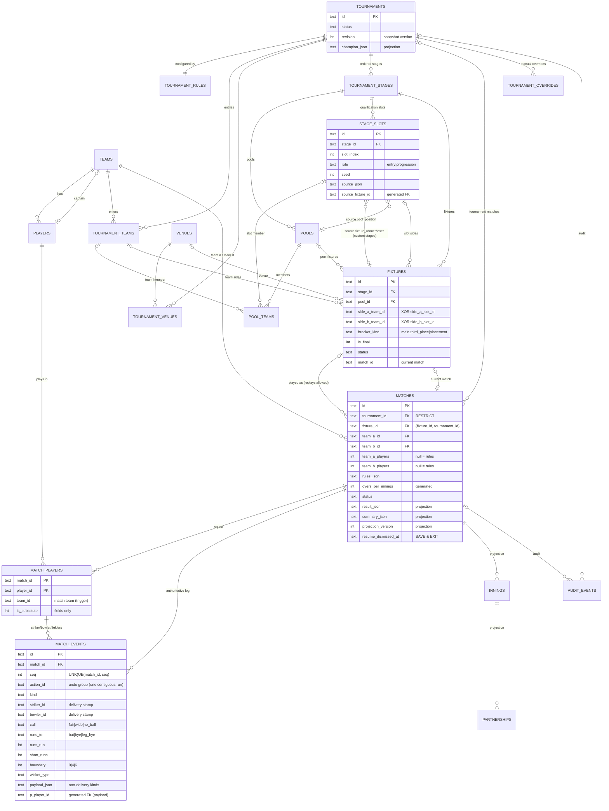

# Scorebook — Database Design

SQLite via expo-sqlite (bundled SQLite 3.50) in the app and sql.js (SQLite 3.49) in node tests. Schema v1: [`src/db/migrations/001_initial.ts`](../../src/db/migrations/001_initial.ts); access contract: [`src/db/types.ts`](../../src/db/types.ts); repositories: [`src/db/repositories/contracts.ts`](../../src/db/repositories/contracts.ts).

## 1. Principles (§57, §59, §89)

* **Authoritative vs projection.** `match_events` is the only source of scoring truth. Everything derived from it (`innings`, `partnerships`, `matches.result_json | winner_team_id | summary_json | projection_version`, and `matches.status` once the log is non-empty) is a *projection* rewritten from replay in the same transaction as every log change and rebuildable at any time (`MatchService.rebuildProjections`). `projection_version` records the engine version (`SCORING_PROJECTION_VERSION`) that wrote it; bootstrap rebuilds older ones. Projections are never written from a replay with error-severity issues. Standings, NRR and qualification are not stored at all — they are computed from `summary_json`; the only tournament projection is `tournaments.champion_json` (for the tournaments list, §82), rewritten by services from `evaluateTournament`.
* **STRICT tables** everywhere: wrong types fail loudly instead of being coerced. Booleans are `INTEGER` 0/1 with CHECK; timestamps ISO-8601 `TEXT`; dates `YYYY-MM-DD` and times `HH:MM` are GLOB-checked; JSON is `TEXT` with `json_valid` CHECKs and domain camelCase keys.
* **Foreign keys on** (`PRAGMA foreign_keys = ON; journal_mode = WAL; synchronous = FULL` set by the client at open, never in a migration; FULL makes every committed ball survive battery loss). FK policy:
  * `RESTRICT` towards the shared library (teams, players, venues): history can never lose its referents; teams, players and venues are archived, not deleted, once used.
  * `CASCADE` from an aggregate root to its children (tournament → stages → pools/slots/fixtures/entries/overrides/audit; match → events, squad, projections).
  * `RESTRICT` from `matches.tournament_id`: deleting a tournament never silently deletes its matches (§55, §99); `TournamentService.delete` deletes them explicitly after a typed confirmation.
  * `NO ACTION` for cross-references *inside* an aggregate and from events to the squad, so a confirmed whole-aggregate delete cascades cleanly while deleting one referenced row (a fixture that feeds a slot, a squad player used by an event) is refused.
  * `DEFERRABLE INITIALLY DEFERRED` for the circular / order-sensitive cross-references (stage_slots ↔ fixtures, fixtures ↔ matches, pool_teams → stage_slots, tournament memberships): checked at COMMIT, so a backup import or a bracket generation may insert in any order inside one transaction, and a dangling reference still aborts it.
  * Membership is enforced across aggregates: pool entries, fixture team sides and tournament matches' teams reference `tournament_teams(tournament_id, team_id)`; a match's fixture must belong to the same tournament (`(fixture_id, tournament_id) → fixtures(id, tournament_id)`); squad rows and innings rows name only the match's two teams (triggers on both sides: `trg_match_players_team_*` / `trg_innings_teams_*` guard the child rows, `trg_matches_teams_update` refuses changing `matches.team_a_id` / `team_b_id` while a squad row, innings row or event team `p_team_id` of that match names a team outside the new pair; a swap is allowed). The parent-side trigger was added to schema v1 before v1 shipped, so it needs no migration of its own.
* **One use case = one transaction** on the transaction's own handle (`withTransactionAsync(async (tx) => …)`); the client holds a writer mutex for the transaction, so statements outside it wait instead of joining it (expo-sqlite alone does not isolate concurrent async statements from an open transaction).
* **No `INSERT OR REPLACE`** (it deletes the old row and cascades); upserts use `ON CONFLICT(id) DO UPDATE`. Batch upserts that rewrite a UNIQUE order column (`order_index`, `slot_index`) run two phases (+1 000 000, then final values) because SQLite checks UNIQUE row by row.

## 2. ERD

## 3. The event log — design decision

**Chosen:** one table `match_events` holding the whole ordered log of a match (`seq` 1..n, contiguous, `UNIQUE(match_id, seq)`), with **typed columns for deliveries** and a **JSON payload for every other kind** (exactly one of the two is populated — enforced by CHECKs).

**Rejected:** §58's split into `balls` + separate innings/other-event tables. Replay needs one total order across deliveries, bowler changes, new batters, retirements, strike swaps, overs revisions, penalties, suspensions and the match end. With two tables the order has to be reconstructed from a shared sequence spread over tables — two sources of truth for ordering, harder undo (which table holds the last action?), harder atomic history rewrite.

Why typed delivery columns rather than all-JSON:
* ≈95% of rows are deliveries; typed columns are compact and let SQLite enforce the Laws-level invariants that never change: `call`/`runs_to` pairing (wides have no `runs_to`), `boundary ∈ {0,4,6}`, six only off the bat, `short_runs ≤ runs_run`, wicket fields together, `dismissal_end` only for run out / obstructing / handled, striker ≠ non-striker.
* **Composite FKs `(match_id, player_id) → match_players`** on the delivery columns (striker, non-striker, bowler, dismissed player, both fielders) AND on VIRTUAL generated columns that expose the player ids inside `payload_json` (`p_player_id` = `$.playerId`, `p_striker_id`, `p_non_striker_id`, `p_bowler_id`, `p_fielder1_id`/`p_fielder2_id` = `$.fielderIds[0|1]`); `p_team_id` (batting team, penalty team, walkover/award winner) references `teams`. So an event can only name a squad member, and a squad member used by ANY event — including an opener who never faced, an over-start bowler replaced before the first ball, or an off-ball fielder — cannot be removed. The only array beyond two elements (`innings_ended.absentees`) is checked by `MatchRepository.removeSquadPlayer` with `json_each`.
* §14/§58 "balls" columns remain queryable in SQL (future career stats) without JSON extraction.

What is **not** stored: over/ball numbers, legality, batter/extra/total runs, balls faced, free hit, strike after the ball, innings completion, targets, results. Those are replay outputs (`BallRecord`, `InningsState`) — storing them would create a second truth that historical edits would have to keep in sync.

Stamps: `striker_id / non_striker_id / bowler_id` on deliveries are **context stamps** validated on append (error) and on replay (warning only — applied with the derived context) and rewritten by `history.normalizeLog` after edits (see CONTRACT_REFERENCE.md, events.ts).

Undo deletes by position, never by action id: `truncateFrom(match_id, seq ≥ first undone seq)` guarded by the expected tail seq. An `action_id` always identifies one contiguous run (history edits give each inserted op a fresh one).

`payload_json` = the domain payload object minus `kind` (camelCase), e.g. `innings_started` → `{"inningsIndex":0,"battingTeamId":"…","strikerId":"…","nonStrikerId":"…","bowlerId":"…"}`; `strike_swapped` / `play_resumed` → `{}`. Player ids inside payloads are validated by the domain against the squad and, for the fixed fields, enforced by the generated-column FKs above (e.g. `bowler_selected` → `{"bowlerId":"…","reason":"over_start"}`, `penalty_awarded` → `{"teamId":"…","inningsIndex":1,"runs":5,"reason":"…"}`).

## 4. Tables

| Table | Kind | Purpose / notes |
|---|---|---|
| `schema_migrations` | meta | Applied migrations (bootstrap SQL in `migrations/index.ts`). |
| `app_settings` | auth. | Key → JSON value (`AppSettings` top-level keys). |
| `venues` | auth. | Library of grounds; `archived_at` soft delete (venues in use are RESTRICT-protected). |
| `teams` | auth. | Library teams; `captain_id` deferred FK (insert team + players in any order); `archived_at` soft delete. |
| `players` | auth. | Home team (`team_id`); guests appear in other teams' squads via `match_players.team_id`. |
| `tournaments` | auth. + proj. | §26 info, §62 `status`, `structure_kind`; date order CHECK; `revision` (bumped by every transaction touching the aggregate, a fixture mirror or a tournament match summary = `TournamentSnapshot.version`); `champion_json` projection (JSON array of team ids, joint winners allowed). |
| `tournament_venues` | auth. | Many-to-many venues. |
| `tournament_rules` | auth. | Points as columns (§58), `nrr_mode` + `nrr_options_json` (rest of `NrrConfig`), `tie_breakers_json` (ordered array), default format/rules. |
| `tournament_teams` | auth. | Membership with seed and `active / withdrawn / replaced` (+ `replaced_by_team_id`, `inherits_from_team_id` for `transfer_to_replacement`; both composite-FK'd to the same tournament's memberships). |
| `tournament_stages` | auth. | Ordered stages (`order_index` unique; parallel Cup/Plate stages get consecutive indexes); `config_json` = `StageConfig` (fixture generation, seeding + seed + normalisation, overrides, **entry rules = §58 qualification_rules**, knockout options incl. rounds, abandoned-match policy, `decidesChampion`, stage match rules). |
| `pools` | auth. | Per stage, unique name and order; `legs` override (null = stage default). |
| `stage_slots` | auth. | §45 slots with `role` (`entry` / `progression`), `seed` (bracket seed of an entry slot) and `source_json` (`SlotSource`, incl. `bracket_winner/bracket_loser` by bracket position); generated columns `source_stage_id / source_pool_id / source_fixture_id / source_team_id` carry real (deferred) FKs; CHECKs: `source_kind` matches the JSON, progression slots only have winner/loser sources of their own stage and no seed. |
| `pool_teams` | auth. | Pool member = team XOR slot; `tournament_id` + composite FK to `tournament_teams`; `UNIQUE(stage_id, team_id)` and `UNIQUE(stage_id, slot_id)` → a team is in one pool per stage. |
| `fixtures` | auth. | Sides team (tournament member) XOR slot (slot FK scoped to the same stage); bracket position with `bracket_kind` (`main` / `third_place` / `placement`, unique per stage+kind+round+position); `is_final` (≤ 1 per stage); `status` (scheduling states owned here; live/completed/abandoned mirror the current match); `match_id` = current match (cleared when an abandoned fixture is rescheduled for a replay), composite FK `(match_id, id) → matches(id, fixture_id)` proves the match belongs to this fixture. The repository joins the current match's teams as `Fixture.matchSides` (frozen sides). |
| `matches` | auth. + proj. | Config (teams, per-team side sizes, rules_json, toss, schedule) is authoritative; teams cannot change while a squad, innings or event row names the old team (`trg_matches_teams_update`); `status` authoritative only while the log is empty (`scheduled/postponed/cancelled`), projection afterwards; `result_json`, `winner_team_id`, `summary_json`, `projection_version` projections; `resume_dismissed_at` (SAVE & EXIT); CHECKs tie status to result (`completed/abandoned ⇔ result`, `abandoned ⇔ result.type = abandoned`). `overs_per_innings`, `result_type` are generated columns. No stage copy: stage/pool come from the fixture. |
| `match_players` | auth. | Squad per match — the FK anchor for event player ids; `is_substitute` (fields only); team must be one of the match's teams (triggers). |
| `match_events` | **authoritative log** | See §3. Index `(match_id, action_id)`, `(match_id, p_player_id)`. |
| `innings` | projection | Score line per innings (`runs, wickets, legal_balls, max_balls, target, extras_json, status, completion_reason` incl. `terminated`) for lists, the resume prompt and history cards without replay; teams checked against the match (triggers). |
| `partnerships` | projection | §58 partnerships for scorecards/PDF. |
| `tournament_overrides` | auth. | §47/§54 overrides incl. `champion`; `payload_json` = full `TournamentOverride` (keeps every id for history); indexed `stage_id / pool_id / slot_id` become NULL when the row is deleted (`ON DELETE SET NULL`), so an old override never blocks re-expanding slots; mandatory `reason`; revoked, never deleted. |
| `audit_events` | auth. (append-only) | §53 (§58 `tournament_events`); `tournament_id` NULL for standalone match corrections and app-level entries; `entity_type` incl. `backup` (entity id = `exportId`) and `app`; `impact_json` = the `ImpactSummary` the organizer confirmed; history edits store removed/inserted events. `action` validated in the domain so new actions need no table rebuild. |
| `tournament_templates` | auth. | §56 user templates (`structure_json` = `TournamentTemplate` minus id/timestamps); built-ins are code. |
| `match_format_presets` | auth. | §8 user presets; built-ins are code. |

### §58 mapping

| §58 table | Realised as |
|---|---|
| tournaments, pools, pool_teams, teams, players, fixtures, venues | same names (pool_teams also holds slot members) |
| tournament_rules | `tournament_rules` (+ stage overrides in `tournament_stages.config_json`) |
| tournament_stages | `tournament_stages` |
| matches | `matches` (`winner` → `winner_team_id` projection; `overs` → generated `overs_per_innings`) |
| innings | `innings` projection |
| balls | `match_events` rows with `kind = 'delivery'` (+ derived `BallRecord` for over/ball/legal/total) |
| partnerships | `partnerships` projection |
| tournament_events | `audit_events` |
| qualification rules (§57) | `tournament_stages.config_json.entryRules` + `stage_slots` |

## 5. Indexes

Every FK used for deletes/filters is indexed: `players(team_id)`, `tournament_teams(team_id)`, `pool_teams(pool_id, order_index)`, `pool_teams(tournament_id, team_id)`, `stage_slots(source_fixture_id | source_pool_id)`, `fixtures(stage_id, pool_id)`, `fixtures(stage_id, bracket_kind, bracket_round, bracket_position)` (unique, partial), `fixtures(stage_id) WHERE is_final` (unique, partial), `fixtures(tournament_id, side_a_team_id | side_b_team_id)`, `fixtures(tournament_id, scheduled_date, scheduled_time)`, `fixtures(tournament_id, status)`, `fixtures(tournament_id, match_number)`, `matches(status, updated_at)` (home/resume), `matches(tournament_id, status)`, `matches(fixture_id)`, `matches(team_a_id)`, `matches(team_b_id)`, `matches(created_at)`, `matches(projection_version)`, `match_players(match_id, team_id, batting_order)`, `match_players(player_id)`, `match_events(match_id, seq)` (unique), `match_events(match_id, action_id)`, `match_events(match_id, p_player_id)`, `tournament_overrides(tournament_id, revoked_at)`, `audit_events(tournament_id, created_at)`, `audit_events(match_id, created_at)`.

## 6. Transactions per use case

| Use case | Writes in ONE transaction |
|---|---|
| Record ball / action | INSERT events (one `action_id`) · UPDATE `matches` projection (+ `projection_version`, clear `resume_dismissed_at`) · UPSERT `innings`/`partnerships` · if terminal: `summary_json`, fixture mirror, stage/tournament status, `tournaments.revision`++, champion projection, `audit_events(result_recorded)` |
| Undo / redo | `truncateFrom(first undone seq)` guarded by the tail seq / re-INSERT group · projections · (reopen or re-close: fixture mirror + revision + champion + audit) |
| Historical edit | fingerprint check · DELETE + INSERT whole log (normalised) · projections · fixture mirror · revision · audit (removed + inserted events, impact) — live or completed |
| Create match | `matches` + `match_players` + opening events (+ `fixtures.match_id`, fixture status, revision) |
| Pool / fixture / stage / rules / seed / override change | version check · rows of the domain `ChangePlan` (two-phase index updates, re-expanded dependent slots) · walkover matches with their events · revision · champion projection · audit with the previewed impact |
| Delete tournament | typed confirmation · each match deleted explicitly · tournament aggregate (cascade) |
| Import backup | per aggregate: skipped / remapped copy / explicit delete then insert · rows in `BackupData` order (circular FKs deferred to COMMIT) · projections rebuilt by replay · `foreign_key_check` · audit `backup_imported` (entity `backup`, id = `exportId`) |

## 7. Migration strategy

* Forward-only, ordered `MIGRATIONS` array; a shipped migration is frozen (never edited). Each migration runs inside one transaction together with its `schema_migrations` row; failure rolls back and startup shows a recoverable error.
* A database whose recorded version is newer than the app's latest migration is never touched (`SchemaTooNewError`).
* After a run that applied at least one migration, `PRAGMA foreign_key_check` must be empty. It is not run on every launch (foreign keys are always on; a full check scans every event row) — also after imports and from Diagnostics.
* SQLite cannot alter CHECK constraints; changing one uses the documented 12-step table rebuild (create new → copy → drop → rename) inside the migration. Such a migration sets `foreignKeysOff: true`: the runner switches foreign keys off before BEGIN, runs `foreign_key_check` before COMMIT (rows → rollback), and switches them back on.
* JSON column shapes evolve with additive optional keys; mappers default missing keys. `MatchSummary.summaryVersion` versions the summary shape; `matches.projection_version` versus `SCORING_PROJECTION_VERSION` drives the bootstrap rebuild of every projection written by an older engine (one transaction per match; logs that need repair are reported, not rewritten).
* Backups carry `schemaVersion` and `formatVersion`; importing an older backup maps the data forward in `export/backup`, a newer one is rejected.
