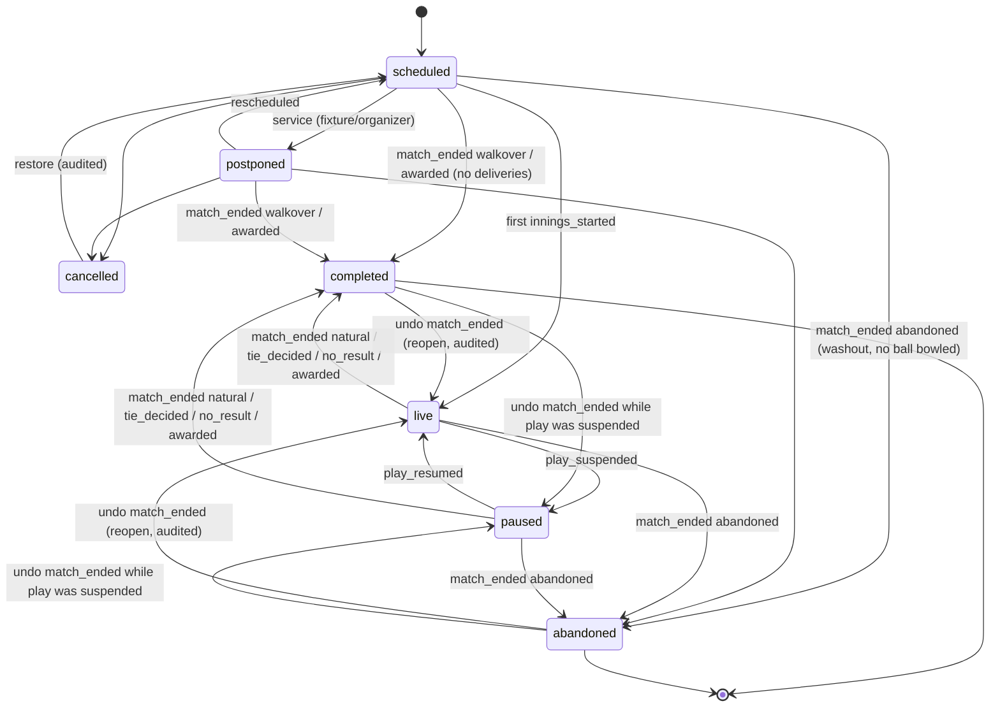
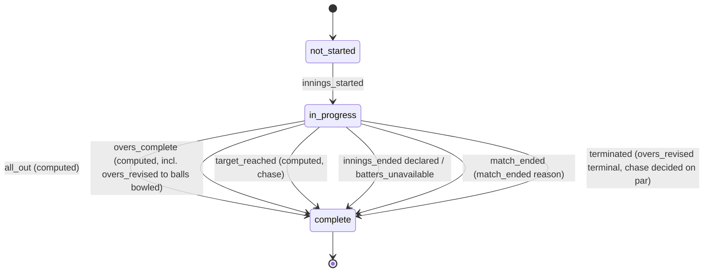
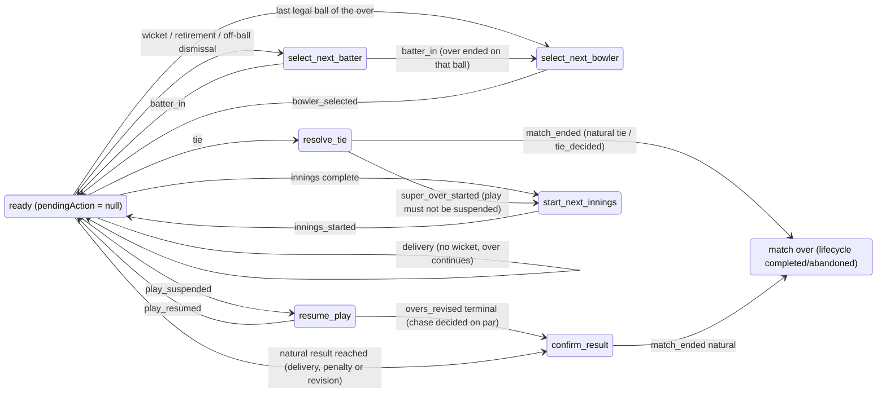
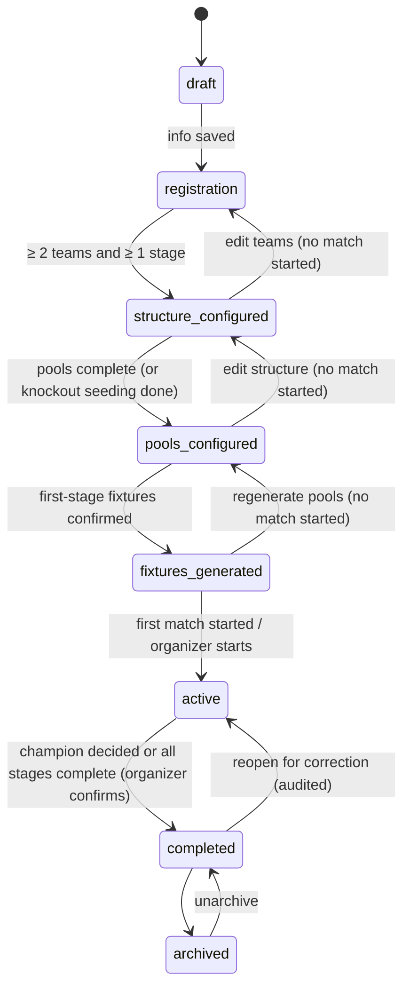
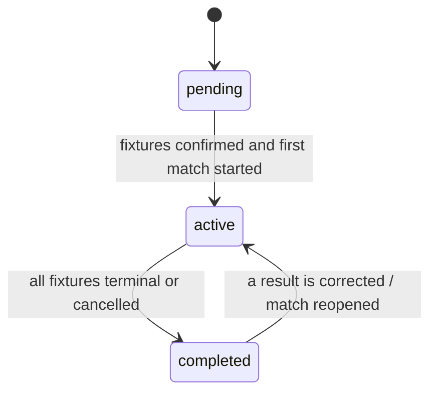
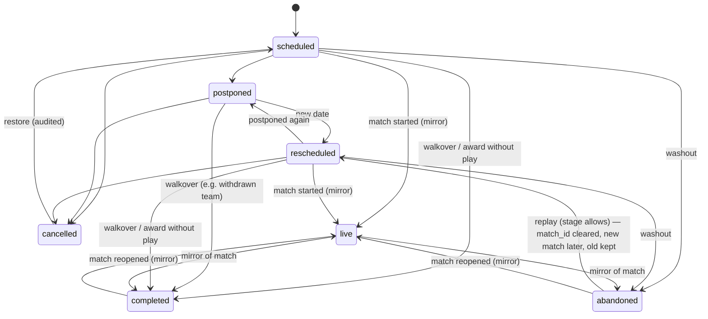

# Scorebook — State Machines

Executable form: [`src/domain/tournament/stateMachine.ts`](../../src/domain/tournament/stateMachine.ts) (guards + edit policies) and the scoring replay (`MatchState.lifecycle`, `InningsState.status`, `PendingAction`). Services call the guards before every status change; the UI uses the edit policies to choose between direct edit, warning, and confirmation-with-reason (§55).

Edit permission legend: **allowed** · **warn** (impact preview, one tap) · **confirm** (impact preview + explicit confirmation + reason, audited) · **forbidden**.

## 1. Match (§22, §61, §63)

Status (`MatchStatus`) is the lifecycle; the outcome is `MatchResult` (see the status/result table under `match.ts` in [CONTRACT_REFERENCE.md](CONTRACT_REFERENCE.md)). Tied / No Result / Walkover (§22) are results of a `completed` match; `abandoned` is both the status and the result type.

Authority: while the event log is empty the stored status (`scheduled | postponed | cancelled`) is authoritative; once events exist the status is derived by replay (`deriveMatchStatus`). "Save & exit" does not change status: a live match stays live, is listed under Continue Match, and is skipped by the startup resume prompt (`resume_dismissed_at`) until the next event is appended (§23).

`paused → completed` by `match_ended natural` covers the rain-terminated chase: `overs_revised { terminal: true }` (valid while paused) completes the chase on the par score, the natural result outranks `resume_play`, and the scorer confirms without a fake `play_resumed`.

A match whose log has error-severity replay issues (`needsRepair`) accepts no write that keeps it degraded (append, redo, endMatch, rules edit); only a history edit or undo whose result replays cleanly (§93).

| Status | Details (title, venue, date) | Teams | Rules | Squad | Toss | Scoring (append) | History edit | Delete |
|---|---|---|---|---|---|---|---|---|
| scheduled / postponed | allowed | allowed | allowed | allowed | allowed | first event only | — | allowed (standalone) / via fixture |
| live / paused | allowed | forbidden | confirm (log must still replay; incl. per-team side sizes; overs → `overs_revised` event) | add allowed (incl. substitute fielders); remove only if no event references the player (FK-enforced, payloads included) | confirm (must match innings 1) | allowed (paused: only `play_resumed`, `match_ended`, overs revision incl. terminal, penalty) | warn (audited) | standalone: DISCARD (confirm); tournament: forbidden |
| completed / abandoned | allowed | forbidden | confirm (audited `match_rules_changed`) | add allowed (audited `match_squad_changed`) | confirm (audited `match_toss_changed`) | forbidden (reopen = undo `match_ended`: confirm) | confirm (+ tournament impact) | confirm (standalone) / forbidden while linked to a fixture |
| cancelled | allowed | allowed | allowed | allowed | — | forbidden | — | allowed |

## 2. Innings and the scoring flow (§19, §21, §64)

A completed innings never reopens for deliveries. A `penalty_awarded` naming a completed innings of the current phase (e.g. on the innings-ending ball) changes its runs; replay then re-runs completion, the natural result and the pending action (a last-ball tie can become a win; a first-innings penalty raises the target). `overs_revised` re-runs them too (a target at or below the current chase runs → `target_reached`).

Match-level sequence: innings 0 → innings 1 (chase, target = innings 0 + penalties + 1 or revised) → natural result → `confirm_result` **or**, on a tie with super overs enabled, `resolve_tie` → `super_over_started {round}` → innings 2k+2, 2k+3 (super-over rules; each round is its own penalty phase; in round ≥ 2 batters dismissed in earlier super overs and the previous super over's bowler are ineligible when `restrictRepeatPlayers`) → result or another `resolve_tie`.

Ball-to-ball prompts (`PendingAction`, first match wins: `confirm_result` | `resolve_tie` > `resume_play` > `start_next_innings` > `select_next_batter` > `select_next_bowler`):

Any state can also reach `finished` through `match_ended {no_result | abandoned | awarded}`; undo moves backwards along any edge.

Mandatory retirement is ADVISORY, not a prompt state: `MatchState.retirementsDue` lists batters who reached `atRuns` (immediately, or at the end of the over with `timing: 'end_of_over'`) while a yet-to-bat batter remains. The UI shows a banner with "Retire" (`batter_retired { retired_not_out }` → `select_next_batter`); scoring continues if the scorer ignores it.

## 3. Tournament (§61, §62, §55)

Edit policy (`tournamentEditPolicy`):

| State / situation | Info | Add teams | Remove team | Stages | Pools | Generate fixtures | Fixture schedule | Fixture teams | Rules (points/NRR/tie-breakers) | Overrides | Match results |
|---|---|---|---|---|---|---|---|---|---|---|---|
| draft · registration · structure_configured · pools_configured | allowed | allowed | allowed | allowed | allowed | allowed | allowed | allowed | allowed | — | — |
| fixtures_generated (no match started) | allowed | warn | warn | warn | warn (fixtures regenerated) | warn | allowed | allowed | allowed | allowed | — |
| active, matches started, none completed | allowed | warn | confirm (withdraw) | warn (future stages) | warn | warn (unplayed only) | allowed | warn (unplayed only) | warn | confirm | warn (live match edits) |
| active, completed matches exist | allowed | confirm | confirm (withdraw, never delete) | confirm (future stages only) | confirm | confirm (unplayed only) | allowed (played: forbidden) | confirm (unplayed only) | confirm | confirm | confirm |
| completed | allowed | forbidden | forbidden | forbidden | forbidden | forbidden | forbidden | forbidden | confirm | confirm | confirm |
| archived | forbidden (unarchive first) | forbidden | forbidden | forbidden | forbidden | forbidden | forbidden | forbidden | forbidden | forbidden | forbidden |

Team seeds (`team_seeds_change`, `tournamentEditPolicy.seeds`) follow the **Rules** column (they reorder tables through the `seed` tie-breaker and drive seeding).

| State / situation | Delete tournament (`tournamentEditPolicy.deleteTournament`) |
|---|---|
| any state, no match started | allowed (typed name) |
| matches started or completed (any state except archived) | confirm: `previewDelete` counts matches, completed matches and events; typed name + explicit "delete completed matches" opt-in; tournament backup offered first; matches deleted explicitly (matches → tournament is RESTRICT) |
| archived | forbidden (unarchive first) |

Never silently: every `warn/confirm` change goes through `previewChange` → `computeImpact` (WHAT WILL CHANGE) with the snapshot version, is applied only if the version is unchanged (`CONFLICT` otherwise), persists the same domain `ChangePlan`, and writes an audit entry with the previewed impact; completed match data is never deleted or altered without explicit confirmation (§55, §99).

## 4. Stage

A stage may be `pending` with unresolved entrants (slots); its fixtures can already exist between slots. Later stages become playable fixture by fixture as their slots resolve (`SlotResolution.status = final`). Once a fixture's match starts, its sides are frozen to the match's teams (`Fixture.matchSides`); a later change of who occupies the slot never rewrites a played fixture — the impact preview reports it as a slot conflict (accept = results stand as played, or pin the slot with a `slot_assignment` override). Stages with no entry rules take every active team not directly entered elsewhere; `direct_entry` rules let teams skip earlier stages.

## 5. Fixture (§38, §39)

This diagram is exactly `canTransitionFixture` ([CONTRACT_REFERENCE.md](CONTRACT_REFERENCE.md), `stateMachine.ts`), which is canonical: 19 edges. Two of them closed contract gap G-8 at the wave-1 integration (2026-10-01, [docs/README.md](../README.md#4-contract-gap-register)). `rescheduled → postponed` lets the organizer postpone a rescheduled fixture again (EC-T-13). `postponed → completed` lets a withdrawn team's postponed fixture become a walkover: `planChange` for `team_withdraw { remainingFixtures: 'walkover' }` creates the walkover match for every remaining fixture, postponed ones included, and the fixture mirrors it (EC-Q-13). Like every mirror target, it needs the match (`hasMatch`). A postponed fixture still cannot go `live` or `abandoned` directly: it is rescheduled first.

`live | completed | abandoned` are written by `MatchService` in the same transaction as the match change; `scheduled | postponed | rescheduled | cancelled` are organizer actions through `TournamentService.updateFixture` (guarded by `canTransitionFixture`; `FixturePatch.status` cannot express the mirror states). `abandoned → rescheduled` requires `replayAllowed` (`StageConfig.abandonedMatches = 'replay'`, or `KnockoutConfig.noResult = 'replay'`) and clears `fixtures.match_id` in the same transaction, so the abandoned result stops counting while the replay is pending; the old match keeps its `fixture_id` for history.

| Fixture status | Date/time/venue | Teams / slots | Stage / pool | Format / overs | Delete |
|---|---|---|---|---|---|
| scheduled / postponed / rescheduled | allowed | allowed (warn if standings/qualification affected) | warn | allowed | warn |
| live | forbidden | forbidden | forbidden | via match (overs revision) | forbidden |
| completed / abandoned | forbidden | forbidden | confirm (moves a result between tables) | forbidden | forbidden (detach/delete the match explicitly first) |
| cancelled | allowed | allowed | allowed | allowed | allowed |
