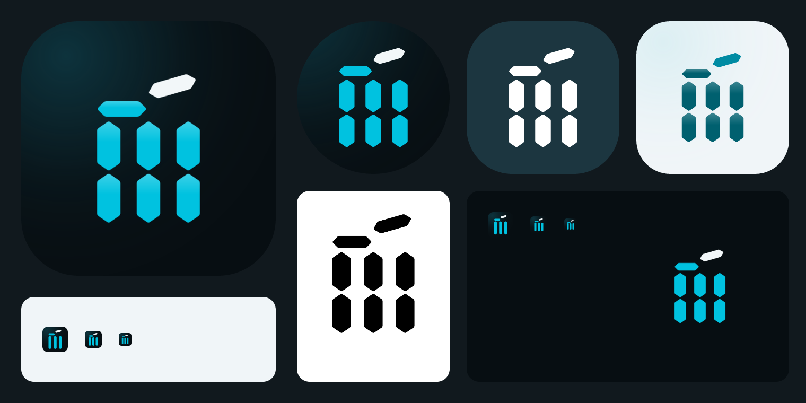

# Scorebook brand mark

Version 1, 2026-10-05. Applies the §107 identity (night-stadium scoring console with liquid glass) to the app icon, adaptive icon, splash and favicon. This document is the source of truth for the mark. Sources are in `scripts/brand/`, and every shipped asset is produced from them by `node scripts/brand/render.mjs`.



## The mark: "Wicket 111"

Three stumps drawn as seven-segment scoreboard digits, with one bail resting and one bail lifting off.

- **Stumps as scoreboard numerals.** Each stump is two chamfered display segments, so the three stumps also read as `111` on a scoreboard. 111, known as "Nelson", is the score every cricket fan recognises.
- **Bails as display segments.** Both bails use the same chamfered segment shape as the stumps, turned horizontal, so the whole glyph is made from one building block.
- **The flying bail.** The right bail lifts off and tilts by 16°, which shows the wicket falling. It is the only element in the light ink colour, which marks the moment that changes the score. It also gives the mark its silhouette and its forward motion.
- **No clip art.** There is no bat, no ball and no gradient fill. The only effect is a subtle glass sheen on the app icon: each cyan segment gets a top highlight that fades from 24% white to nothing over its upper 42%.

The mark is geometric and built on a 640-unit grid:

| Element | Geometry (640 grid) |
|---|---|
| Stump | 94 wide, centres at x = 160 / 320 / 480 (66 gap), 32-unit chamfered tips, 7-unit corner rounding |
| Segment split | Upper segment y 210–410, lower segment y 420–620 (10-unit break) |
| Resting bail | x 113–313, y 130–192 (62 high), pointed ends |
| Flying bail | Same shape as the resting bail at x 345–545, y 66–128, rotated −16° about (332, 187) |
| Optical box | x 113–527, y ≈ 24–620; centre (320, 320); height 600 is the placement unit used by the renderer |

## Variants

| File | Use |
|---|---|
| `scripts/brand/mark.svg` | Primary mark with split segments. Use it at 64 px and larger. |
| `scripts/brand/mark-small.svg` | Small-size mark: each stump is one solid segment, because the 10-unit break blurs below 64 px. Use it from 16 px to 63 px (favicon, notification-size placements). |
| `scripts/brand/tile-dark.svg` | Obsidian app-icon field with the §107 top-left ambient glow (`#0D3843`). |
| `scripts/brand/tile-light.svg` | Ice field with a faint cyan ambient (`#DCEFF3`) for light-surface placements. |

Colourways are applied by `render.mjs`, which swaps the two source colours in `mark.svg`:

| Colourway | Stumps + resting bail | Flying bail | Field |
|---|---|---|---|
| Dark (primary) | `#00C2E0` cyan (9.1:1 on obsidian) | `#F2F7F9` ink (18:1) | `#070E12` obsidian |
| Light | `#00606F` deep teal ink (6.6:1 on ice) | `#008BA3` deep teal (3.7:1) | `#F0F5F8` ice |
| Monochrome | one colour, usually `#FFFFFF` or `#000000` | same colour | any |

In light mode, bright cyan `#00C2E0` is only 1.95:1 on ice, so it never colours the mark there. This matches the §107 rule that cyan is decorative on light surfaces.

## Clear space and minimum size

- **Unit S** is the stump width (94 / 600 of the mark height, about 16%).
- **Clear space:** keep at least 1 S of empty space around the optical box on all sides. Inside an icon tile, the mark is placed at 600 / 1024 of the tile height, which leaves more than 2 S.
- **Minimum size:** use the primary mark at 64 px and larger, and the small-size mark from 16 px to 63 px. Never show the mark below 16 px.
- The silhouette has to hold up as a single colour. If a placement cannot show the three stumps and the lifted bail as separate shapes, it is too small.

## Shipped assets

| Asset | Spec | Source |
|---|---|---|
| `assets/images/icon.png` | 1024², fully opaque (the script checks every pixel's alpha), dark tile + primary mark at 600 px with sheen | `tile-dark.svg`, `mark.svg` |
| `assets/images/android-icon-background.png` | 432², opaque obsidian with ambient glow | `tile-dark.svg` |
| `assets/images/android-icon-foreground.png` | 432², transparent, mark 188 px high; the furthest ink is 107 px from centre, inside the 132 px (66 dp) safe-zone radius, which the script checks | `mark.svg` |
| `assets/images/android-icon-monochrome.png` | 432², white silhouette with the same placement and the same check (Android 13 themed icons) | `mark.svg` |
| `assets/images/splash-icon.png` | 1024², transparent, mark 900 px high; shown at `imageWidth` 120 on `#070E12`, so the ink stays within about 60 dp of centre, inside the 96 dp Android 12 splash mask | `mark.svg` |
| `assets/images/favicon.png` | 48², rounded obsidian tile (22% radius) with transparent corners + small-size mark | `tile-dark.svg`, `mark-small.svg` |
| `assets/expo.icon/` | iOS 26 Icon Composer bundle: solid obsidian fill and two glass groups. The flying bail is the front group. The resting bail and stumps are the back group, so the system's Liquid Glass gives the wicket depth. Layers are full-canvas 1024 SVGs. | `mark.svg` split by group id |
| `scripts/brand/preview/brand-sheet.png` | Review sheet: rounded app icon, circle-masked adaptive icon, themed monochrome, light tile, black silhouette, and favicons at 48 / 32 / 24 on dark and ice | all of the above |

`app.json` points `icon`, `ios.icon`, `android.adaptiveIcon.*`, `web.favicon` and the `expo-splash-screen` plugin at these files. The splash and adaptive `backgroundColor` are both `#070E12`, which matches `BRAND_SPLASH_COLOR` in `src/ui/theme/tokens.ts`.

## Usage rules

- Do not redraw, re-proportion, outline or add effects to the mark. Change `mark.svg` and re-run the renderer instead.
- Do not put the dark colourway on a light field or the light colourway on obsidian. Use the matching colourway, or monochrome.
- Do not add a ball, a bat, a wordmark lock-up inside the icon tile, gradients, neon glows or drop shadows. On iOS 26 the system adds the glass and the shadow.
- Do not straighten the flying bail. The lifted bail is the signature element.
- The mark is not a UI icon. In-app chrome keeps using the lucide line icons, and the mark only appears as the app's identity.

## Regenerating

```bash
node scripts/brand/render.mjs
```

The script needs only the dev dependency `@resvg/resvg-js`. It overwrites every asset listed above, rebuilds `assets/expo.icon/Assets/` from scratch, and fails if an opacity, transparency or safe-zone check breaks. Look at `scripts/brand/preview/brand-sheet.png` after every change.
